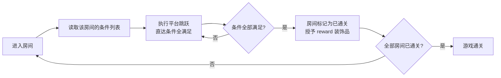

# 01 — 游戏设计

> 坐标、命名、Z 层、目录见 `00-conventions.md`。物理手感数值见 `06`，渲染见 `07`，格式见 `03`。

## 1.1 定位

一句话：**在一张由房间串成的大地图里，用小动物在像素平台上跳跃，逐房间达成目标，集齐 30 件纯外观装饰品。**

| 项 | 值 |
|---|---|
| 类型 | 2D 平台跳跃（单机、离线、单角色） |
| 视角 | 侧视，正交，相机跟随角色；视野小于一个房间（看不到整间房） |
| 美术 | 像素风，瓦片/角色/装饰品均为 32×32 |
| 输入 | 键盘（方向 + 跳跃）为主，手柄为辅；不做触屏/鼠标操作 |
| 目标平台 | Windows 桌面（本机 win32）；跨平台不是本阶段目标 |
| 单局时长 | 全通关（示例 30 房间）≈ 30–60 分钟 |

## 1.2 核心循环



- 循环粒度是**房间**，不是关卡。地图无缝，玩家无需也不应被迫"退出房间"。
- 循环的驱动是**条件列表**（见 §1.4），不是单一出口。

## 1.3 角色

| 项 | 约定 |
|---|---|
| 形象 | 小动物（占位资产用纯色方块 + 耳朵/眼睛色块），32×32 精灵 |
| 碰撞体 | AABB，尺寸见 `06` |
| 首批能力 | 左右移动、跳跃、**可变跳跃高度**（早松手跳得矮）、coyote time、jump buffer |
| **不做**（明确排除） | 攻击、二段跳、冲刺、滑翔、爬墙、抓取/搬运、生命值/血量 |
| 受伤 | **无血量概念**。碰到 `Hazard` 即死亡 → 回到存档点/出生点（§1.7） |
| 朝向 | 左右翻转 sprite（`Sprite::flip_x`），不改变碰撞体 |

> 排除项都是"看起来该有"的加戏，会让首批里程碑失控。它们各自需要新的输入、动画、关卡设计约束与测试面。要加必须走 `AGENTS.md` 的「新能力」流程并单独排期。

## 1.4 房间目标：条件列表

房间的通关判定是一个**条件列表**，全部条件满足 ⇒ 房间通关。

```ron
goals: [ ReachExit, Collect(count: 5) ]
```

### 首批条件类型（D7）

| 条件 | 语义 | 附加校验（见 `03`） |
|---|---|---|
| `ReachExit` | 玩家 AABB 与房间内的 `exit` 区域 AABB 相交 | 房间内**恰好 1 个** `exit` 实体 |
| `Collect(count: n)` | 该房间内已被收集的 `fruit` 数量 `>= n` | `1 <= n <= 房间内 fruit 总数` |
| `CollectAll` | 该房间内**全部** `fruit` 已被收集 | 房间内 fruit 数量 `>= 1` |

- 条件之间是**逻辑与**（AND）。**设计规则：每个房间至少一个目标**——但这是关卡设计约定，**不由代码强制**：
  空列表能通过校验，运行时永不满足（不会自动通关），用于允许半成品关卡保存与调试。
- 条件求值发生在 `Update` 的 `RoomSet` 内，**只在玩家处于当前房间时求值**（避免离屏房间被误判定，也避免无谓开销）。
- 通关判定是**单调**的：一旦满足，房间永久标记 `cleared`，**不可回退**。
- 通关后玩家仍可继续在该房间活动（无缝地图，不做强制传送）；重复满足不再触发奖励。

### Roadmap 条件（不在首批，格式保留扩展位）

`Timed(secs)`（限时）、`Switches(n)`（触发机关）、`DefeatAll`（清空敌人）。新增一类条件必须同时：改 `03` 的枚举 + 校验规则、改 `01` 本表、补条件求值纯函数单测。

## 1.5 奖励与装饰品

| 项 | 约定 |
|---|---|
| 数量 | 与房间数一一对应（示例 30 房间 → 30 件） |
| 作用 | **纯外观**（D8）。不加能力、不做门禁、不参与通关判定 |
| 授予时机 | 房间首次通关的那一刻，自动授予（不需要拾取、不需要返回） |
| 重复授予 | 幂等。已拥有的装饰品不再重复加入 |
| 装备 | 槽位数与槽位语义见 `04` §6.1（`DECORATION_LAYERS`）；**每个槽位至多装备 1 件**，重复装备 = 替换 |
| 未装备 | 该槽位不渲染任何内容（不创建实体，见 `04` §6.3） |
| 图层顺序与 Z | 见 `04` §6.1（Z 值公式本身在 `00` §0.4） |
| id 集合 | 装饰品 id 的**唯一来源是所有关卡 `.level.ron` 的 `reward` 字段并集**（`03` §3.2）。本项目**不**维护单独的装饰品清单文档，避免与关卡数据漂移 |
| 图鉴 UI | 首批**不做**。装饰品选择在暂停菜单里做（M6） |

- 装饰品的 `id` 是稳定契约，与资源文件名绑定（见 `00` §0.5）。**改名 = 破坏存档**，因此一旦发布不得改名；需要改名时必须写存档迁移。
- 装饰品是**独立的 32×32 图层**，不参与角色动画（角色跑动时装饰品跟随角色 `Transform`，自身不做帧动画）。这样 30 件装饰品只需 30 张静态图。

## 1.6 通关与进度

| 结束条件 | 触发 | 结果 |
|---|---|---|
| **游戏通关** | 全部房间 `cleared == true` | 进入 `GameState::GameComplete`，展示结算（已收集 N/M 装饰品） |
| 死亡 | 玩家 AABB 与 `Hazard` 相交 | 无惩罚计数；重置到**已激活存档点**，没有存档点时回到**关卡出生点**；清空速度与跳跃状态 |
| 退出 | 玩家主动退出 | 存档 |

- 没有"失败"状态：死亡只是回到已激活的存档点（没有存档点则回到房间重生点）。
- 不影响进度的房间（奖励已领）不重复结算。

## 1.7 重生点与存档点

- 存档点是关卡里的 `checkpoint` 实体（`03` §3.4）：玩家站在其区域内按 `E` 即激活，**立即写入存档**。
- 死亡回退优先级：
  1. 已激活的存档点（可跨房间）；
  2. 关卡出生点：`player_spawn` 所在房间的重生点（房间 `spawn` 字段 > 引擎默认值，见 `02` §重生点）。
     与死亡时所在房间无关；不记录"最后安全位置"。
- 激活的存档点持久化在 `SaveData` 中；重启游戏后直接从存档点所在房间/位置继续（`05` §5.11）。
- 玩家死亡 → 传送后速度与跳跃状态清零（完整清单见 `06` §死亡重置）。

## 1.8 关卡与房间规模

| 项 | 值 | 说明 |
|---|---|---|
| 示例规模 | `10 × 3 = 30` 房间 | 与 30 件装饰品对齐，是本阶段的内容目标 |
| 建议上限 | 单个关卡 ≤ 64 房间 | 超过后关卡加载与全量渲染策略需要重新设计（见 `07` 裁剪） |
| 房间尺寸 | 16×16 瓦片 = 512×512 像素 | D5，见 `00` §0.3 |
| 起始房间 | 由 `.level.ron` 的 `start` 指定 | 起房间内必须有 `player_spawn` |

### 地形语言（设计约束）

| 元素 | 默认用法 | 说明 |
|---|---|---|
| `#` 实心 | **绝大多数地形** | 四面阻挡：墙、地面、台阶、悬空平台一律用它 |
| `=` 单向平台 | **隐藏通道专用** | 只能从上方站住、下方可穿过。用于"跳上去发现秘道"的少数点位，**不作为普通平台** |
| `^` 尖刺 | 危险 | 不阻挡，接触即死亡 |
| `*` 装饰 | 背景 | 无碰撞 |

- 房间网格是**二维**的：除左右相邻外还有**上下纵深**（`row = 0` 为最上一行，`00` §0.3）。
- 垂直相邻的两个房间在瓦片网格上**无缝**：上房底行与下房顶行直接相邻，所以"下房顶行留坑 = 通往上房 / 上房底行留坑 = 掉进下房"是最简单的纵深连通方式（`02` §2.1、`03` V18 会以 Warning 提示边界不连续）。
- 单向平台的**数量必须远少于**实心块：它本身就是"这里有秘道"的线索，用多了玩家就不再相信地板。
  目前唯一合规用法：竖井内的上行台阶（`world_01` 两处竖井各 6 级，2 格间距 = 64 px 可逐级上跳）与
  `rooms[20]` 的隐藏通道（同为单向台阶）。

## 1.9 范围：里程碑与非目标

### 里程碑（每个里程碑都必须可运行、可观察）

| # | 里程碑 | 完成判据（可观察） |
|---|---|---|
| M0 | 骨架 ✅ **已完成（2026-10-16）** | `cargo game` 打开窗口，内层离屏管线生效（窗口按整数倍放大，倍数与黑边规则见 `07`）；画面无模糊、无 MSAA 锯齿；网格 gizmo 可切换。**实测证据**：`VERIFY: PASS` 8/8，截图逐像素比较 1 048 576 / 0 差异（`09` §9.8.1；当时视口为 512²，2026-10-19 起视口缩小，见 `09` V13） |
| M1 | 移动 ✅ **已完成（2026-10-17）** | 在一张手写测试房间里，角色能跑、跳、撞墙、站上单向平台；coyote time 与 jump buffer 可实测生效。**实测证据**：`physics` 的 T1–T21 全绿（`cargo test -p game`，36 项）；`cargo game -- --demo jump` 在真实 App 里 5 次跳跃峰值全部 **80.00 px**（解析值 80.0，见 `06` §6.2.6）；角色以 32×32 渲染且脚底精确贴合地板顶面（截图逐像素核对） |
| M2 | 房间与相机 ✅ **已完成（2026-10-17；2026-10-19 改为跟随 + 地图边界钳制，视野缩小到小于一个房间）** | 相机中心每帧跟随玩家 AABB 中心，并钳制在关卡 AABB 内（视野不越界）；跨界不抖动；视野小于一个房间（尺寸见 `07` §7.1.1）。**实测证据**：`cargo game -- --frames 90 --screenshot target/m0` 自检 **11/11 PASS**（含 `camera follows player`），窗口 == 画布 × 2 逐像素 **0 差异**；`camera::rig` 单测锁定地图内精确跟随、四边钳制、任意位置视野不越界、单房间内按半视野钳制；房间判定（4 方向 + 滞回边界 7.9 px 不切 / 8.0 px 切 + 幂等）由 `room` 单测锁定。靠近边界时视野同时覆盖相邻房间（可见性按相机视野矩形判定，`07` §7.8.3） |
| M3 | 关卡数据 ✅ **已完成（2026-10-17）** | `.level.ron` 经 loader 加载并通过校验；非法关卡给出**可定位到字段**的错误；热重载改文件即时生效。**实测证据**：运行中把房间 0 平台从 4 格改成 5 格 → 日志 `关卡热重载：world_01 → world_01（2 个房间，43 个瓦片）`（原 42）；运行中写入非法字符 → `[rooms[0].tiles[0]] V6 rooms[0].tiles[0]: 列 0 的字符 'X' 不在 legend 中` + `关卡热重载被拒绝：1 条阻断性问题，继续使用旧关卡`；`cargo test -p game` 共 **46** 项（新增 `clamp_room` 与 `tile_count` 用例） |
| M4 | 目标与奖励 ✅ **已完成（2026-10-17）** | 两种条件类型可用、可组合；通关房间弹出提示并授予装饰品；全部通关进入结算。**实测证据**：`room::tests::m4_pipeline_pickup_clear_reward_complete`（无头确定性）覆盖**拾取果实 → 条件同时满足 → 通关 → 授奖（幂等）→ 全通进入 `GameComplete`**；真实 App 内 `--demo walk` 走过出口触发 `房间 (0, 0) 通关（1/2）` 且自检 11/11 PASS；`cargo test -p game` 共 **70** 项。条件类型三种全实现（`ReachExit` / `Collect(n)` / `CollectAll`），求值只针对当前房间、单调不可回退（`01` §1.4） |
| M5 | 关卡编辑器 ✅ **已完成（2026-10-17，范围见下）** | 编辑器内画瓦片、放实体、改条件、保存、就地试玩并返回，编辑缓冲不丢。**实测证据**：`cargo test -p editor` **9 项**（单瓦片索引、撤销/重做全量快照、幂等写入、底行映射、goals/reward 事务、保存往返=恒等、Fatal 阻断写盘、快速拖动采样去重）；`animj-editor --frames 90 --screenshot target/editor` 退出码 0、egui 初始化、截图 459 色；`--demo-play`：进入试玩（`game` 用 `doc` 重建世界）→ 退出 → **编辑缓冲逐字节一致、`dirty=false`**（`08` §8.6.3 R3）。工具集 1–6 全部可用（含 `MoveEntity`）；区域框选已明确移除。**明确顺延**（不是"已完成"）：编辑态热重载消费与回环抑制、错误列表点击定位、`Ctrl+Shift+S` 另存为、缩放锚点跨帧自检、`Shift` 约束 |
| M6 | 打磨 ✅ **已完成（2026-10-17）** | 暂停菜单 + 装饰品装备界面 + 存档读档 + 音效 + 30 房间内容 + 性能裁剪（feature 裁剪）。**实测证据**：30 房间关卡（`10×3`，1157 个非空瓦片实体）`validate-levels --deny-warnings` **0 error / 0 warning**；`cargo test -p game` **84** 项（含 R4 逐房校验 30 个重生点、R6 网格契约、存档规则、装备幂等、帧动画、音效映射）；真实 App：`房间 (0, 0) 通关（1/30）`、`读档：房间 0/30 已通关`、`DEMO 峰值上升 = 80.00 px`、`音效：audio/jump.wav`、暂停菜单冒烟 0 panic；`cargo test-all` **133** 项。**已知内容限制**：竖井目前只能**下行**（上行需要梯子/单向平台台阶，尚未加入内容）；该限制属内容设计，不是引擎缺陷。M5 遗留的 5 项（热重载消费、错误点击定位、另存为、缩放自检、`Shift` 约束）**已全部补齐**（`08` §8.10.5）。**内容说明**：隐藏通道在 `rooms[20]` 的 tile 12，一列**整格外观**的单向平台台阶（间距 2 格 = 64 px，可逐级上跳）；单向平台的占位图已恢复为**完整单格**，与普通地板外观一致 |
| M7 | 基础界面 ✅ **已完成（2026-10-20）** | 主菜单（开始游戏 / 读取存档 / 设置 / 退出）、关卡选择（扫描 `assets/levels/*.level.ron`）、设置（音量 10 档 + 无边框全屏，写 `settings.ron`）、暂停菜单增加「设置」「主菜单」。**实测证据**：`--demo menu/levels/settings` 各产出窗口截图（UI 由独立窗口相机渲染，文字按原生分辨率光栅化）；`--demo click` 注入真实 `PointerInput` 后日志 `点击生效：已进入关卡选择`（拾取链路）；`--hide-ui` 下窗口 == 画布 × 2 逐像素 **0 差异**；`--demo settings` 日志 `音量 -> 80%` / `全屏：开` / `全屏：关`，`settings.ron` 落盘 `volume: 0.8`；`--demo menu-start` 主菜单→关卡选择→`关卡 world_01 校验通过`→`已进入游戏`；`--demo restart` 回主菜单再开一局，第二轮 **玩家 1 / 房间根 30** 且自检 **11/11 PASS**；`--demo load-save` 走 `Continue` 读档（`读档：房间 0/30 已通关`）；暂停菜单冒烟仍 PASS |

### 非目标（本阶段明确不做）

- 敌人 AI、战斗、Boss。
- 多关卡串关流程（关卡选择界面已落地；关卡之间不串进度、不做解锁链）。
- 联网、排行榜、成就、云存档。
- 手柄重绑定 UI、多语言、无障碍。
- 移动端 / Web 构建。
- 程序化关卡生成。
- 手柄之外的输入设备（鼠标操作角色）。

> 任何一项进入范围前，必须先改本文档的里程碑表，再动手。
