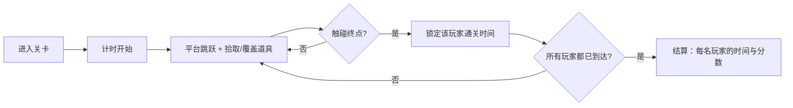

# 01 — 游戏设计

> 坐标、命名、Z 层、目录见 `00-conventions.md`。物理手感数值见 `06`，渲染见 `07`，格式见 `03`。

## 1.1 定位

一句话：**在一张由房间串成的大地图里，用小动物在像素平台上跳跃，拾取道具穿越地形，率先/依次抵达唯一终点；通关时间决定分数。**

| 项 | 值 |
|---|---|
| 类型 | 2D 平台跳跃（单机 / **本地双人** / **局域网联机**，单房间最多 4 人） |
| 视角 | 侧视，正交，**每个玩家一个视角**：联机时各自跟随自己的角色；本地双人左右分屏；视野小于一个房间 |
| 美术 | 像素风，瓦片/角色均为 32×32；道具当前用占位色块 |
| 输入 | 键盘（方向 + 跳跃 + `E`）为主，手柄为辅；本地双人共享键盘（键位见 `06` §6.1.6）；不做触屏/鼠标操作 |
| 目标平台 | Windows 桌面（本机 win32）；跨平台不是本阶段目标 |
| 单局时长 | 示例关卡速通 ≈ 3–10 分钟；时长取决于路线与道具使用 |

## 1.2 核心循环

- 循环粒度是**整张关卡**，不是房间。房间只用于地图组织、相机视野与加载裁剪。
- 房间**没有目标**：没有 `goals`、没有房间通关、没有房间奖励。
- 玩法驱动是**终点**与**限时**：路线选择、道具取舍、失误代价都体现在通关时间上。

## 1.3 角色

| 项 | 约定 |
|---|---|
| 形象 | 小动物（占位资产用纯色方块 + 耳朵/眼睛色块），32×32 精灵 |
| 碰撞体 | AABB，尺寸见 `06`；**玩家之间不碰撞**（可互相穿过，只与瓦片碰撞，见 `06` §6.11） |
| 基础能力 | 左右移动、跳跃、**可变跳跃高度**（早松手跳得矮）、coyote time、jump buffer |
| 道具能力 | 由拾取的道具临时提供：**高跳 / 快跑 / 双跳**（§1.5、`06` §6.12） |
| **不做**（明确排除） | 攻击、冲刺、滑翔、爬墙、抓取/搬运、生命值/血量 |
| 伤害 | **无血量概念**。碰到 `Hazard` 即死亡 → 回到存档点/出生点，并**清除道具 buff**（§1.7） |
| 朝向 | 左右翻转 sprite（`Sprite::flip_x`），不改变碰撞体 |

> 道具是**临时能力**，不是永久解锁：换道具即换能力，10 秒后或死亡时清除。

## 1.4 终点

- 关卡里有且只有 **1 个 `goal` 实体**（`03` V23），可以是任意房间。
- 任一玩家的 AABB 与 `goal` 区域相交 ⇒ **该玩家**锁定自己的通关时间（每人只记第一次），并继续游戏等待其他玩家。
- 所有在场玩家都到达终点 ⇒ 进入 `GameComplete` 结算。单人时等价于「碰到终点即获胜」。
- 终点不再按房间判定，也不依赖任何条件列表。

## 1.5 道具

| 项 | 约定 |
|---|---|
| 拾取 | 玩家 AABB 与 `item` 区域相交即拾取（外扩 `PICKUP_INFLATE`）；一次性 `item` 销毁，`item_spawner` 生成的道具隐藏并进入重生倒计时 |
| 生成器 | `item_spawner` 在自身位置生成道具；被拾取后固定 **1.5 秒**重新生成（`ITEM_RESPAWN_SECS`，主机权威） |
| 容量 | **每个角色同时只携带一个道具**；再次拾取**覆盖**原有道具（不叠加、不排队） |
| 持续 | 拾取后 buff 持续 **该道具类型配置的秒数**（默认 10 秒，`Level.items[*].duration_secs`），超时自动清除；覆盖拾取会重置为满 |
| 类型 | `SuperJump`（高跳）、`Speed`（快跑）、`DoubleJump`（双跳），枚举见 `03` §3.5 |
| 贴图 | 按 `ItemKind` 在关卡级 `items` 中**共享**设置 `sprite` 并框选 32×32 格；不按单个实体设置（`04` §6） |
| 编辑器 | 底部「道具」面板统一编辑三种道具的贴图、贴图格与持续时间 |
| 生效 | 只影响携带者的物理参数副本（`06` §6.12），不改变全局常量 |
| 死亡 | **清除**当前道具 buff；避免死亡后仍带着限时能力（`01` §1.5） |
| 存档 | 不持久化道具（它不是收集/解锁内容，只是关卡内的临时状态） |
| HUD | 显示焦点玩家当前道具名与耗时 |
| 视觉 | 优先使用编辑器设置的 PNG；未设置时用不同颜色的 12×12 色块（`04` §6） |

## 1.6 通关、计时与分数

| 项 | 约定 |
|---|---|
| 计时起点 | 进入 `GameState::Playing` 后的第一个固定步；暂停/加载不累计（`run::advance_run_clock`） |
| 计时粒度 | 固定步 1/60 秒累加；显示保留两位小数 |
| 通关时间 | 每名玩家**第一次**触碰终点的时刻；不可改写 |
| 结算条件 | 所有在场玩家都已有通关时间（单人 = 触碰终点） |
| 分数公式 | `score = round(max(0, SCORE_BASE − 通关秒数 × SCORE_PER_SECOND))`；常量归本节，代码在 `config`/`run` |
| 结算展示 | 每名玩家的通关时间与分数；未到达者显示「未完成」 |
| 联机 | 主机权威计时与终点判定；快照同步 `run_elapsed` 与每名玩家的 `finish` |

> 分数常量：`SCORE_BASE = 10000`、`SCORE_PER_SECOND = 10`（`crates/game/src/run.rs`）。改数值必须同步本节。

## 1.7 重生点与存档点

- 存档点是关卡里的 `checkpoint` 实体（`03` §3.4）：玩家站在其区域内按 `E` 即激活，**立即写入存档**。
- 死亡回退优先级：
  1. 已激活的存档点（可跨房间）；
  2. 关卡出生点：`player_spawn` 所在房间的重生点（房间 `spawn` 字段 > 引擎默认值，见 `02` §重生点）。
     与死亡时所在房间无关；不记录"最后安全位置"。
- 激活的存档点持久化在 `SaveData` 中；重启游戏后直接从存档点所在房间/位置继续（`05` §5.11）。
- 玩家死亡 → 传送后速度与跳跃状态清零、**道具 buff 清除**（完整清单见 `06` §死亡重置）；计时**不暂停**（死亡是速通成本的一部分）。

## 1.8 关卡与房间规模

| 项 | 值 | 说明 |
|---|---|---|
| 示例规模 | `10 × 3 = 30` 房间 | 纵向 3 行构成多条路线 |
| 建议上限 | 单个关卡 ≤ 64 房间 | 超过后关卡加载与全量渲染策略需要重新设计（见 `07` 裁剪） |
| 房间尺寸 | 16×16 瓦片 = 512×512 像素 | D5，见 `00` §0.3 |
| 起始房间 | 由 `.level.ron` 的 `start` 指定 | 起房间内必须有 `player_spawn` |
| 终点 | 全关卡任意房间，恰好 1 个 | 不要求与起始房间相连（由关卡设计保证可达） |

### 地形语言（设计约束）

| 元素 | 默认用法 | 说明 |
|---|---|---|
| `#` 实心 | **绝大多数地形** | 四面阻挡：墙、地面、台阶、悬空平台一律用它 |
| `=` 单向平台 | **隐藏通道专用** | 只能从上方站住、下方可穿过。用于"跳上去发现秘道"的少数点位，**不作为普通平台** |
| `^` 尖刺 | 危险 | 不阻挡，接触即死亡 |
| `*` 装饰 | 背景 | 无碰撞 |

- 房间网格是**二维**的：除左右相邻外还有**上下纵深**（`row = 0` 为最上一行，`00` §0.3）。
- 垂直相邻的两个房间在瓦片网格上**无缝**：上房底行与下房顶行直接相邻，所以"下房顶行留坑 = 通往上房 / 上房底行留坑 = 掉进下房"是最简单的纵深连通方式（`02` §2.1、`03` V18 会以 Warning 提示边界不连续）。
- 单向平台的**数量必须远少于**实心块：它本身就是"这里有秘道"的线索，用多了玩家就不再相信地板。
  目前唯一合规用法：竖井内的上行台阶（`world_01` 两处竖井各 6 级，2 格间距 = 64 px 可逐级上跳）与
  `rooms[20]` 的隐藏通道（同为单向台阶）。
- 道具放置：示例关卡在出生房间 `r00` 放两个「快跑 / 高跳」生成器用于引导与贴图验证，`r03` 集中展示三种一次性道具；关卡设计应保证任意路线都能在需要高跳/双跳的位置附近拿到对应道具。

## 1.9 范围：里程碑与非目标

### 里程碑（每个里程碑都必须可运行、可观察）

| # | 里程碑 | 完成判据（可观察） |
|---|---|---|
| M0 | 骨架 ✅ **已完成（2026-10-16）** | `cargo game` 打开窗口，内层离屏管线生效（窗口按整数倍放大，倍数与黑边规则见 `07`）；画面无模糊、无 MSAA 锯齿；网格 gizmo 可切换。**实测证据**：`VERIFY: PASS` 8/8，截图逐像素比较 1 048 576 / 0 差异（`09` §9.8.1；当时视口为 512²，2026-10-19 起视口缩小，见 `09` V13） |
| M1 | 移动 ✅ **已完成（2026-10-17）** | 在一张手写测试房间里，角色能跑、跳、撞墙、站上单向平台；coyote time 与 jump buffer 可实测生效。**实测证据**：`physics` 的 T1–T21 全绿（`cargo test -p game`，36 项）；`cargo game -- --demo jump` 在真实 App 里 5 次跳跃峰值全部 **80.00 px**（解析值 80.0，见 `06` §6.2.6）；角色以 32×32 渲染且脚底精确贴合地板顶面（截图逐像素核对） |
| M2 | 房间与相机 ✅ **已完成（2026-10-17；2026-10-19 改为跟随 + 地图边界钳制，视野缩小到小于一个房间）** | 相机中心每帧跟随玩家 AABB 中心，并钳制在关卡 AABB 内（视野不越界）；跨界不抖动；视野小于一个房间（尺寸见 `07` §7.1.1）。**实测证据**：`cargo game -- --frames 90 --screenshot target/m0` 自检 **11/11 PASS**（含 `camera follows player`），窗口 == 画布 × 2 逐像素 **0 差异**；`camera::rig` 单测锁定地图内精确跟随、四边钳制、任意位置视野不越界、单房间内按半视野钳制；房间判定（4 方向 + 滞回边界 7.9 px 不切 / 8.0 px 切 + 幂等）由 `room` 单测锁定。靠近边界时视野同时覆盖相邻房间（可见性按相机视野矩形判定，`07` §7.8.3） |
| M3 | 关卡数据 ✅ **已完成（2026-10-17）** | `.level.ron` 经 loader 加载并通过校验；非法关卡给出**可定位到字段**的错误；热重载改文件即时生效。**实测证据**：运行中把房间 0 平台从 4 格改成 5 格 → 日志 `关卡热重载：world_01 → world_01（2 个房间，43 个瓦片）`（原 42）；运行中写入非法字符 → `[rooms[0].tiles[0]] V6 ...` + `关卡热重载被拒绝：1 条阻断性问题，继续使用旧关卡` |
| M4 | 房间目标与奖励 ⛔ **已被 v3 移除（2026-11-08）** | 原 `ReachExit` / `Collect` 条件与装饰品奖励已删除；通关改由终点实体触发（§1.4）。相关代码、存档字段、编辑器 UI、资产均在同一改动内移除 |
| M5 | 关卡编辑器 ✅ **已完成（2026-10-17，范围见下）** | 编辑器内画瓦片、放实体、保存、就地试玩并返回，编辑缓冲不丢。**实测证据**：`cargo test -p editor` 41 项（单瓦片索引、撤销/重做全量快照、幂等写入、底行映射、实体按房间管理、实体命中与拖动、外部改动确认/另存为、地块碰撞范围编辑、玩家碰撞配置、道具笔刷）；`animj-editor --frames 90 --screenshot target/editor` 退出码 0、egui 初始化、截图非空；`--demo-play`：`试玩往返后编辑缓冲一致 = true（dirty = false）` |
| M6 | 打磨 ✅ **已完成（2026-10-17；v3 起去掉装饰品装备）** | 暂停菜单 + 存档读档 + 音效 + 30 房间内容 + 性能裁剪。装饰品装备界面与相关存档字段已随 v3 移除；暂停菜单保留继续/设置/保存/主菜单/退出 |
| M7 | 基础界面 ✅ **已完成（2026-10-20）** | 主菜单（开始游戏 / 读取存档 / 设置 / 退出）、关卡选择、设置（音量 + 全屏 + 中英文）、暂停菜单增加「设置」「主菜单」。**实测证据**见 `docs/AGENTS.md` §4（M7 行） |
| M8 | 多人联机 ✅ **已完成（2026-10-20）** | 本地双人 + 局域网联机（主机权威、最多 4 人）+ 房间搜索。v4 协议同步道具、二段跳状态、本局计时与每名玩家的通关时间 |
| M9 | 道具 / 终点 / 计时评分 ✅ **已完成（2026-11-08）** | 拾取三种道具并覆盖、生成器 1.5 s 重生、编辑器可设道具贴图、触碰唯一终点、各自计时、全员到达后按时间计分结算。**实测证据**：`cargo test-all` 全绿；`--demo walk` 日志 `玩家 0 拾取道具：Speed（空手），生成器 1.5 秒后重生` → `道具生成器：重新生成 Speed` → 再次拾取覆盖；`--demo goal` 日志 `玩家 0 到达终点` / `全部玩家到达终点…进入结算`，截图结算面板显示「玩家 1 用时 0.40秒 9996 分」；道具 PNG 贴图在实机截图里可见；`validate-levels --deny-warnings` 0 error / 0 warning |

### 非目标（本阶段明确不做）

- 敌人 AI、战斗、Boss。
- 多关卡串关流程（关卡选择界面已落地；关卡之间不串进度、不做解锁链）。
- 公网联机、账号、匹配大厅、排行榜、成就、云存档、反作弊（局域网联机已进入范围，见 M8）。
- 手柄重绑定 UI、多语言、无障碍。
- 移动端 / Web 构建。
- 程序化关卡生成。
- 手柄之外的输入设备（鼠标操作角色）。

> 任何一项进入范围前，必须先改本文档的里程碑表，再动手。
