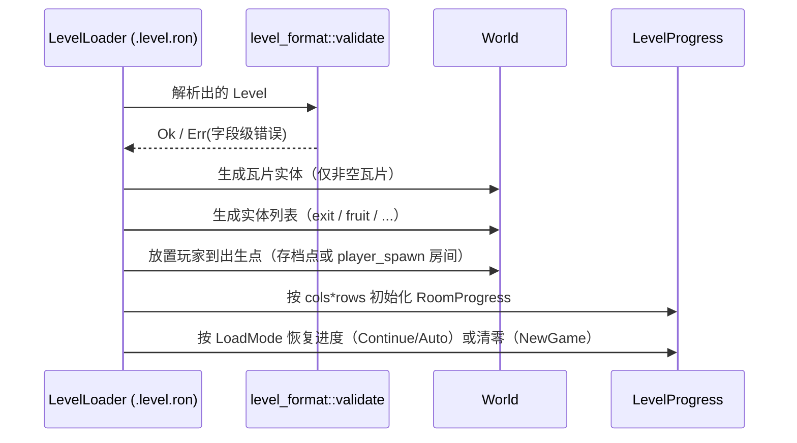

# 02 — 世界、房间与相机

> 坐标公式、房间网格定义、转换函数见 `00-conventions.md` §0.3。**本文不重复那套算术**。
> 本文拥有：相机行为常量、房间切换判定常量、房间状态模型、重生点默认值。

## 2.1 拓扑：房间网格

- 一个 Level = `cols × rows` 个房间的**矩形网格**，示例 `10 × 3 = 30`。
- 房间的定位、世界 AABB、中心点、行主序索引规则全部由 `00` §0.3 定义，本文只消费。
- **房间是无缝的**：不存在"房间之间"的空间，也没有加载/过场。相邻两个房间在世界像素上是紧贴的 512×512 矩形，边界处 1 像素缝隙都不允许。

### 无缝的实现约束

| 约束 | 说明 |
|---|---|
| 瓦片数据自包含 | 每个房间独立存 16×16 瓦片；引擎**不**在房间边界自动生成墙 |
| 不自动补墙 | 想隔开两个房间，必须在瓦片数据里画上 `Solid`；想连通，就两边都留 `Air` |
| 接缝是设计责任 | 编辑器负责可视化边界；`animj-dev validate-levels` 可选的接缝检查见 `08` §CLI |
| 地图外 = `Solid` | 瓦片查询落在关卡 AABB（`cols*512 × rows*512`）之外时，一律返回 `Solid`。这是地图的隐形外框墙，避免玩家掉出世界，也避免额外的越界逻辑 |

> 「地图外 = Solid」是**引擎级不变量**，任何绕过 `coords` 模块自己算瓦片索引的实现都会破坏它。

## 2.2 相机

### 跟随与地图边界

- 相机中心**每帧**跟随玩家 AABB 中心（`Update` 的 `GameSet::Camera`），不做平滑/插值。
- 关闭相机跟随的视野越界：内层视野 = `VIEWPORT_W × VIEWPORT_H`（**小于一个房间**，尺寸见 `07` §7.1.1）。关卡 AABB = `cols*ROOM_PX × rows*ROOM_PX`，
  相机中心被钳制在单轴 `[view/2, map_extent − view/2]`，因此视野**永远完全落在地图内**。
- 某轴的地图尺寸不足视野时（正常关卡不会出现），该轴相机钉在地图中心。
- 相机与当前房间**解耦**：`CurrentRoom` 只服务于目标/HUD/裁剪，不再决定相机位置。
- 相机 `Transform.translation` 的 `x/y` 最终必须落在**整像素**上（取整由 `07` 的统一像素吸附系统完成，本文不自行取整）。

### 常量（本文所有）

| 常量 | 值 | 含义 |
|---|---|---|
| `ROOM_SWITCH_HYSTERESIS` | `8.0` px | 玩家 AABB 中心必须深入新房间超过该距离，才承认切换。**只影响 `CurrentRoom`，不影响相机** |
| `DEFAULT_SPAWN_LOCAL` | `(256.0, 466.0)` | 房间默认重生点（**房间局部坐标**，原点左上、+Y 向下）。是 **AABB 中心**：`480 − 28/2 = 466` ⇒ 脚底恰好贴房间底行地板的顶面（480）。写成 480 会让身体埋进地板 14 px，进而压扁碰撞盒（`06` §6.4.9） |

- 相机跟随是**无状态**的：每帧由「玩家中心 + 关卡尺寸」直接算出，无需插值状态机。
- 边界附近视野会同时覆盖相邻房间，因此视觉裁剪按「与视野矩形相交」判定（`07` §7.8.3）。

### 当前房间判定

```
玩家 AABB 中心 c → 所属房间 r(c)
若 r(c) != 当前房间:
    若 c 到「r(c) 与该房间共享的那条边界」的垂直距离 >= ROOM_SWITCH_HYSTERESIS:
        当前房间 = r(c)
```

- 判定输入是**玩家 AABB 的中心**在世界坐标下的位置（不是 Transform）。
- 滞回的作用：玩家在边界上来回蹭时，`CurrentRoom`（HUD / 目标 / 房间事件）不会来回切换。相机与此判定**解耦**，始终跟随玩家 AABB 中心。
- 判定每帧在 `Update` 的 `GameSet::Room` 内执行一次（见 `05`）。逻辑与 `FixedUpdate` 的物理步长解耦。

## 2.3 房间状态与进度

```rust
/// 行主序索引 = row * cols + col，与 List<Room> 布局一致
struct RoomProgress {
    cleared: bool,      // 目标条件曾全部满足（单调，不可回退）
    collected_fruit: u32, // 该房间已收集的 fruit 数量（单调）
}

struct LevelProgress {
    level_name: String,       // 与 .level.ron 的 name 一致
    grid: (u32, u32),         // 用于校验存档与当前关卡是否同一张图
    rooms: Vec<RoomProgress>, // len == cols * rows
}
```

| 规则 | 说明 |
|---|---|
| 索引唯一来源 | `row_major_index(col, row, cols) = row * cols + col`（`00` §0.3） |
| 单调性 | `cleared` 与 `collected_fruit` **只增不减**；死亡与重进房间都不重置 |
| 存档校验 | 读档时若 `level_name` 或 `grid` 与当前关卡不符 → 丢弃该存档的进度并提示，**不做猜测性映射** |
| 房间重入 | 允许；已 `cleared` 的房间不再触发奖励 |

### 热重载（M3 起）

| 情形 | 行为 |
|---|---|
| 触发 | Bevy 资产文件监听（`AssetPlugin` + `bevy/file_watcher` 特性，`dev` 构建已含）。`*.level.ron` 保存后资产管线重新加载并发 `AssetEvent::Modified` |
| 校验通过 | 替换关卡数据、重建瓦片、`CurrentRoom` 越界时回退到起始房间；**玩家位置不动**（不打断操作） |
| 校验不通过 | 逐条打印 `[字段路径] 规则编号 …`（如 `[rooms[0].tiles[0]] V6 …`），**继续使用旧关卡**，会话不被破坏 |
| 幂等 | 一次保存可能触发多次 `Modified`；重复应用结果一致（重建瓦片 + 幂等写 `Visibility`） |

> 实现位置：`crates/game/src/world/load.rs::hot_reload_level`（`GameSet::Room`，仅 `Playing`）。

### 关卡加载流程

入口：菜单/关卡选择写入 `StartRequest { level_id, mode }`，`OnEnter(GameState::Loading)` 发起资产请求；
编辑器用 `StartupFlow::Direct` + `LoadMode::Auto` 直达默认关卡（`05` §5.5）。



- 任一环节失败 → 进入明确的错误态并**打印可定位的错误**（房间索引 + 字段名），不静默降级。
- 全关恰好 1 个 `player_spawn`（V12），**可位于任意房间**；启动时 `CurrentRoom` 与玩家位置都取该房间（不再强制 `start` 房间）。

## 2.4 实体的生命周期

| 实体类 | 生命周期 | 理由 |
|---|---|---|
| 瓦片 sprite | 关卡加载时一次性生成（仅非空瓦片），关卡卸载时销毁 | 静态 |
| `exit` / `fruit` / `checkpoint` 等房间实体 | 关卡加载时生成，常驻；存档点由玩家按 `E` 激活 | 房间无缝，任何时刻都可能在视野附近 |
| 玩家 | 关卡加载时生成，死亡时重置位置而非销毁重建 | 保留装饰品装备状态 |
| 粒子和临时特效 | 播放完毕即销毁 | 一次性 |

- **逻辑层不做房间级激活/卸载**：本阶段关卡规模（≤ 64 房间）下无收益，却有"玩家在边界上时该不该激活隔壁房间"的语义陷阱。
- 视觉层的房间可见性裁剪属于 `07`，与逻辑无关。
- Roadmap：当单关卡房间数需要 > 64 时，引入 `RoomActivationPlugin`（按当前房间 ±1 环激活），届时本节与 `07` 的裁剪章节必须同步更新。

## 2.5 存档点、死亡与重生

- 存档点：关卡内的 `checkpoint` 实体（`03` §3.4）。
  - **激活**：玩家 AABB 与实体区域相交时按 `E` ⇒ 把该实体的 `(房间, at)` 设为当前存档点，并立即写盘（`05` §5.11）。
  - 同一时刻只有一个生效存档点；在另一个存档点按 `E` 会覆盖它。
  - 存档点位置沿用关卡文件约定：`at` 是 **AABB 中心**（房间局部坐标），与 `player_spawn` 相同。
- 触发死亡：玩家 AABB 与任意 `Hazard` 瓦片 AABB 相交，或（Roadmap）与危险实体相交。
- 结果：
  1. 玩家位置 = **已激活的存档点**；若尚未激活（或存档点已被关卡编辑删除）⇒ **关卡出生点**
     （`player_spawn` 所在房间的重生点：优先房间 `spawn` 字段，否则 `DEFAULT_SPAWN_LOCAL`）。
     无论玩家死在哪个房间，无存档点时都回出生点，**不**使用死亡时所在房间的重生点。
     - 存档点可能在**其它房间**：重生时把 `CurrentRoom` 一并切到该房间；相机在同一帧跟随重生位置。
     - 值一律是 **AABB 中心**（不是脚底）；脚底位于 `中心.y + PLAYER_SIZE.y/2`。
     - 关卡重生点**不得压在 `Hazard` 上**（否则死亡→重生→立刻再死）；`R4` 测试锁住出厂关卡的这一性质。
  2. 玩家速度、跳跃状态、coyote/jump-buffer 计时器全部清零（完整清单见 `06` §死亡重置）。
  3. 相机位置 = 重生位置（相机每帧跟随玩家，因此回到出生房间或存档点时视野随之切换，无过渡）。
  4. `LevelProgress` **不**受影响。
  5. 发 `PlayerDied { room_index }` 消息（用于后续音效/特效）。
- 启动时：若存档里有有效存档点，玩家从该存档点所在房间/位置开始（`05` §5.11）；否则沿用 `player_spawn` 房间。
- 不扣命、不计数、不弹窗。死亡必须是"低摩擦、可立即重试"的。

## 2.6 房间进入事件

- 玩家进入一个此前未进入过的房间时，发 `RoomEntered { room_index }`。
- 首批仅用于调试 HUD 显示与编辑器，**不**用于任何门禁或进度逻辑（保持房间无依赖、可任意顺序挑战）。
