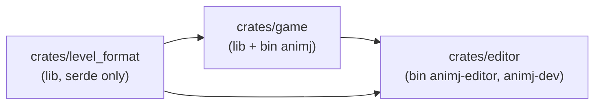
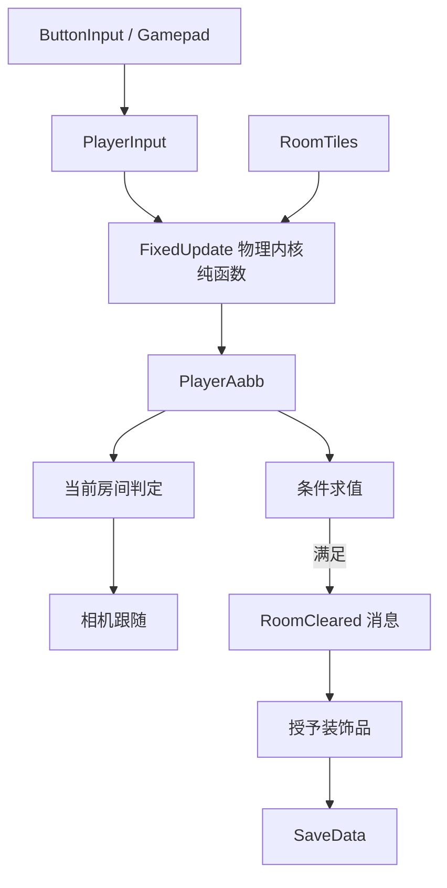

# 05 — 工程架构

> 契约与目录见 `00-conventions.md`。物理内核见 `06`，渲染管线见 `07`，依赖与 Cargo 见 `09`，Bevy API 速查见 `10`。

## 5.1 依赖方向



- **禁止反向依赖**：`game` 不得依赖 `editor`；`level_format` 不得依赖 `bevy`。
- 编辑器通过**复用 `game` 的插件**来获得「就地试玩」，而不是复制一份游戏逻辑。

## 5.2 模块树

### `crates/level_format/src/`

| 文件 | 内容 |
|---|---|
| `lib.rs` | 重导出 + crate 文档 |
| `types.rs` | `Level` / `Room` / `EntitySpec` / `Goal` / `Grid` / `RoomCoord`（见 `03` §3.2） |
| `legend.rs` | 字符 ↔ `TileKind` 映射（见 `03` §3.3） |
| `io.rs` | `read()` / `write()` 单入口（见 `03` §3.1） |
| `validate.rs` | `validate()` 纯函数，返回全部 `LevelIssue`（见 `03` §3.7） |
| `error.rs` | `LevelError` + `LevelIssue` + `Severity` + 手写 `Display`（不引入 `thiserror`，见 D15） |
| `migrate.rs` | 版本迁移函数（见 `03` §3.8）。**v1 无迁移可言，首次版本升级时才新增该文件** |

### `crates/game/src/`

| 路径 | 内容 |
|---|---|
| `lib.rs` | `pub fn add_game_plugins(app: &mut App)` —— 注册全部玩法插件，**不含** `DefaultPlugins`/窗口/资产源/任何编辑器类型。两个 bin 各自负责外壳（`DefaultPlugins`、`AssetPlugin.file_path` 见 `09` §9.6） |
| `config/{mod,physics,render,room,net,ui}.rs` | **所有运行时常量的唯一代码落点**（所有者文档见各文件头注释；`net` 归本文 §5.15，`ui` 归 `07` §7.10.5） |
| `coords.rs` | `room_local_to_world` / `world_to_room` / `room_center`（`00` §0.3 的唯一换算入口） |
| `physics/{mod,aabb,tile,core,tests}.rs` | **纯函数物理内核**（`06`）：`Aabb`、`TileWorld`/`TileKind`、`step`、`overlaps_tile_kind`，以及 T1–T21 不变量测试 |
| `player/{mod,input,spawn,death}.rs` | ECS 适配层（`06` §6.1.5）：`PlayerMotion`/`PlayerInput`、输入采样、生成、Hazard 死亡与重生 |
| `demo.rs` | 验证用脚本输入与物理度量（`--demo walk` / `--demo jump`），见 `AGENTS.md` §4 |
| `tiles.rs` | `RoomTiles` / `LevelTiles` 存储、`tile_at_world`、以及 `TileWorld` 的房间映射实现（`06` §6.6） |
| `state.rs` | `GameState`（含 `OnlineMenu`）、`GameSet`、`StartupFlow`、`SettingsReturn`、`SessionMode` |
| `net/{mod,protocol,discovery,host,client}.rs` | 局域网联机（本文 §5.15）：消息编解码、房间搜索、主机权威快照、客户端输入/应用 |
| `i18n.rs` | 语言枚举 `Language` + 中/英文案表 + 状态名（`05` §5.14） |
| `fonts.rs` | UI 字体加载（`assets/fonts` → `ANIMJ_UI_FONT` → 系统 CJK；`04` §9） |
| `settings.rs` | 全局设置（音量/全屏）：`GameSettings`、路径、读写、投射到 `GlobalVolume` / `WindowMode`（`05` §5.13） |
| `level_asset.rs` | `Level` 的 Bevy `Asset` 包装 + `AssetLoader` 注册 + `Asset` 事件热重载 |
| `world/load.rs` | `StartRequest`/`LoadMode` → 校验 → 生成瓦片 sprite → 生成实体与角色 → 放置玩家 |
| `world/progress.rs` | `LevelProgress` / `RoomProgress`（见 `02` §2.3） |
| `player/decor.rs` | 装饰品装备与图层渲染（`01` §1.5、`04` §6） |
| `checkpoint.rs` | 存档点：`E` 激活、`ActiveCheckpoint`、死亡/启动落点（`02` §2.5） |
| `camera/rig.rs` | 每个视图的相机跟随：自己的玩家 AABB 中心 + 地图钳制（无平滑，`02` §2.2） |
| `room/mod.rs` | 当前房间判定（含滞回） |
| `room/goals.rs` | **纯函数**条件求值 + 通关判定（`01` §1.4） |
| `room/reward.rs` | 授予装饰品（幂等） |
| `render/pixel_camera.rs` | 多视图相机（1–2 台内层世界 / 外层整数缩放 / UI 窗口）+ `ViewLayout` + `UiScale = k`（`07` §7.1.2、§7.2.2、§7.10.1） |
| `render/snap.rs` | 像素吸附 + `Aabb → Transform` 投影（`06` §6.8.2） |
| `render/tiles.rs` | 瓦片 sprite 批量生成 + 房间可见性裁剪 |
| `render/parallax.rs` | 2D 视差背景（`03` §3.10 / `07` §7.13）：贴图平铺、相位与滚动、编辑器预览覆盖、mtime 重载 |
| `render/sprite_anim.rs` | 自写帧动画（`04` §5） |
| `render/hud.rs` | 屏幕空间 HUD（目标药丸 / 独立提示条 / 结算面板） |
| `render/pause.rs` | 暂停菜单 + 装饰品装备界面（`Esc` 开关；含「设置」「主菜单」入口） |
| `render/menu.rs` | 主菜单 / 关卡选择 / 联机 / 设置界面（仅发布 bin；`05` §5.5、`07` §7.10.5） |
| `render/ui_kit.rs` | UI 设计系统组件：调色板角色、按钮/卡片/面板、`Hovered`/`Pressed`/`Outline` 反馈、`TabNavigationPlugin` |
| `render/debug.rs` | gizmos 网格、`F3` 调试开关、诊断行（dev feature，见 `07` §7.9） |
| `anim_data.rs` | 角色动画数据（`assets/anim/player.anim.ron`，`04` §5.5）：类型/校验/加载器/内置回退 |
| `save/mod.rs` | `SaveData` + `save_path()` + 原子写（M6） |

> **当前进度（2026-10-20，M8）**：已落地 `lib.rs` / `config/{mod,physics,render,room,net}.rs` / `coords.rs` / `physics/**` /
> `player/{mod,input,spawn,death,decor}.rs` / `demo.rs` / `tiles.rs` / `state.rs` / `settings.rs` / `level_asset.rs` /
> `world/{mod,load,progress}.rs`（加载 + 校验 + 热重载 + 进度）/ `room/{mod,goals,reward}.rs`（房间判定、
> 传感器、条件求值、授奖、全通）/ `camera/{mod,rig}.rs`（多玩家中点 + 地图钳制）/
> `net/{mod,protocol,discovery,host,client}.rs`（本地双人之外的局域网联机）/
> `render/{mod,pixel_camera,snap,tiles,hud,pause,menu,debug}.rs` / `save/mod.rs`。
> **尚未落地**：编辑器侧的区域框选（已明确移除，见 `08` §8.10.5）。
> 不要去找不存在的文件。

### `crates/editor/src/`

| 路径 | 内容 |
|---|---|
| `bin/animj_editor.rs` | `animj-editor` bin：构建带 egui 的 App，复用 `game::add_game_plugins`（路径见 `09` §9.5.4） |
| `bin/animj_dev.rs` | `animj-dev` bin：`validate-levels` / `gen-placeholder-assets`（见 `08` §8.10） |

> **M5 现状（2026-10-17）**：`editor` 已是 lib crate，按职责拆成下列模块；`bin/animj_editor.rs`
> 只剩外壳（CLI + 截图 + 帧上限）。`bin/animj_dev.rs` 里不得出现 `use bevy`（`08` §8.2.3）。

| 路径 | 内容 |
|---|---|
| `src/lib.rs` | `EditorMode`（编辑器独有状态）+ `EditorPlugin` + 首次从 `LoadedLevel` 取 `doc` |
| `src/session.rs` | `EditorSession`（唯一真相）、全量快照撤销/重做、原子保存、校验结果 |
| `src/camera.rs` | 唯一相机、档位缩放、平移、`Home`、`Tab` 切房间、光标→瓦片 |
| `src/view.rs` | `doc` 投影（瓦片/实体）+ Gizmos 网格/边界/当前房间 |
| `src/tools.rs` | 工具编号 1–6、拖拽所有权、线采样、实体放置/拖动 |
| `src/ui.rs` | egui 四栏面板（顶/左/右/底） |
| `src/playtest.rs` | 就地试玩：校验闸门 → 注入 `game` → 退出恢复 |
| `src/tile_tool.rs` | 地块工具：调色板增删改、贴图路径/列数、32×32 网格选格（`03` §3.9） |
| `src/anim_tool.rs` | 动画编辑工具：工作副本、帧增删、校验、原子保存（`04` §5.5） |
| `src/io.rs` | 编辑态热重载消费（检测 → 确认 → 文本级回环抑制） |
| `bin/animj_dev.rs` | `validate-levels` / `gen-placeholder-assets`（`08` §8.10） |

## 5.3 插件与职责

| 插件 | 职责 | 关键依赖 |
|---|---|---|
| `CorePlugin` | `GameState` / `GameSet` 注册、`Time<Fixed>` 配置 | 无 |
| `LevelAssetPlugin` | 注册 `Level` 资产与 loader | `level_format` |
| `WorldPlugin` | 关卡加载与生成、热重载（校验通过才替换）、`LevelProgress` | `LevelAssetPlugin` |
| `PhysicsPlugin` | — （M1 起物理并入 `PlayerPlugin`：`FixedUpdate` 的 `GameSet::Physics`；将来多实体物理再拆出） | `TilePlugin` |
| `TilePlugin` | `RoomTiles` 存储与查询 | `WorldPlugin` |
| `PlayerPlugin` | 输入采样、物理步推进、朝向（输入方向 ⇒ `PlayerFacing`，`01` §1.3）、Hazard 死亡与重生（`02` §2.5、`06` §6.1.5/§6.5.3） | `TilePlugin` |
| `CheckpointPlugin` | `E` 激活存档点、当前存档点状态与标记高亮（`02` §2.5） | `PlayerPlugin`、`RoomPlugin` |
| `PlayerSpawnPlugin` | 角色图集句柄（`04` §3.2） | 无 |
| `DemoPlugin` | 验证用脚本输入 + 物理度量（仅 `--demo` 时由 bin 添加） | 无 |
| `RoomPlugin` | 当前房间、条件求值、奖励 | `WorldPlugin` |
| `CameraRigPlugin` | 每个视图的相机跟随自己的玩家并钳制在关卡 AABB 内（`GameSet::Camera`，Update） | `WorldPlugin` |
| `ParallaxPlugin` | `Level.background` → 平铺 sprite；`ParallaxCamera` 视图换算；`BackgroundOverride` 预览；`PostUpdate` 早于 `Propagate` | `TileRenderPlugin`（`load_image`）、`WorldPlugin` |
| `PixelRenderPlugin` | 1–2 台内层 + 外层 + UI 相机、视图布局、窗口自适应、整数缩放、`UiScale` 同步 | 无 |
| `TileRenderPlugin` | 瓦片 sprite 生成与可见性 | `WorldPlugin` |
| `SpriteAnimPlugin` | 帧动画 + 按朝向水平翻转 sprite（装饰品同步镜像，`04` §4.5） | 无 |
| `SavePlugin` | 读档（版本/地图/存档点校验）+ 通关/授奖/设置存档点/退出即存。**客户端 `run_if(not_client)` 全部跳过** | `WorldPlugin`、`RoomPlugin` |
| `NetPlugin` | `SessionMode` 资源、主机/客户端生命周期、UDP 收包、快照广播/应用、`OnlineMenu` 房间搜索（本文 §5.15） | 无（只依赖 `std::net` + `serde`/`ron`） |
| `HudPlugin` | HUD（目标药丸 / 独立提示条 / 结算面板） | `CorePlugin`、`UiKitPlugin` |
| `PausePlugin` | 暂停菜单 + 装饰品装备界面（`GameState::Paused`，`Esc` 开关）；「设置」进 `Settings`、「主菜单」先存档再回 `MainMenu` | `CorePlugin`、`UiKitPlugin` |
| `MenuPlugin` | 主菜单 / 关卡选择 / 联机 / 设置 UI。**只由 `add_render_plugins` 注册（发布 bin）**；写入 `StartRequest` 驱动加载 | `WorldPlugin`、`SavePlugin`、`SettingsPlugin`、`CorePlugin`、`UiKitPlugin` |
| `UiKitPlugin` | UI 设计系统：按钮/卡片/面板构造、`Hovered`/`Pressed`/`Outline` 反馈、`TabNavigationPlugin` 与 `AutoFocus` 约定 | 无 |
| `SettingsPlugin` | 读设置 → `GlobalVolume` + 主窗口 `WindowMode`；变化后原子写 `settings.ron`。**只由发布 bin 注册** | 无 |
| `UiFontPlugin` | 加载唯一 UI 字体并暴露 `UiFont::text_font(px)`；编辑器与发布 bin 共用（`04` §9） | 无 |
| `AudioFxPlugin` | 事件 → 音效（`04` §6.9；物理结果与 `05` §5.6 的消息） | `RoomPlugin`、`PlayerPlugin` |
| `DebugPlugin` | gizmos / 诊断（仅 `dev` feature） | 全部 |

## 5.4 调度顺序

```rust
// state.rs
#[derive(SystemSet, Debug, Clone, PartialEq, Eq, Hash)]
pub enum GameSet { Input, Physics, PostPhysics, Room, Camera, Fx, Snap }
```

| 调度 | 集合/系统 | 说明 |
|---|---|---|
| `PreUpdate` | `GameSet::Input` | 采样输入为 `PlayerInput`（纯数据） |
| `FixedUpdate` | `GameSet::Physics`：`apply_player_physics → activate_checkpoint → check_hazards → respawn_on_death`（依次排序） | 固定 60 Hz。**所有位移与碰撞只在这里发生**；存档点先于死亡判定，因此同一固定步里按 E 设置的点会立即生效 |
| `Update` | `GameSet::PostPhysics` | 把 `FixedUpdate` 结果同步到 `Transform`，触发一次性消息 |
| `Update` | `GameSet::Room` | 当前房间判定、条件求值、通关与奖励 |
| `Update` | `GameSet::Camera` | 每个视图的相机直接跟随自己的玩家 AABB 中心（钳制在地图内，无平滑） |
| `Update` | `GameSet::Fx` | 动画、粒子、音效触发 |
| `PostUpdate` | `GameSet::Snap`：`.before(TransformSystems::Propagate)`（`.after` 会延迟一帧，见 `07` §7.6.3） | 像素吸附（`07`） |

- `Time<Fixed>` 的配置（**已验证**，且 0.20 官方示例即用此写法）：`insert_resource(Time::<Fixed>::from_hz(60.0))`。
- 输入在 `PreUpdate` 采样 → `FixedUpdate` 消费：单帧内多次物理步会复用同一份输入（这正是平台跳跃想要的确定性）。
- **禁止**在 `Update` 里直接改位置；渲染层的插值/吸附是唯一例外，且不得回写逻辑 `Aabb`。

## 5.5 状态与模式

```rust
#[derive(States, Default, Clone, Copy, PartialEq, Eq, Hash, Debug)]
pub enum GameState {
    #[default] Boot,
    MainMenu, LevelSelect, OnlineMenu, Settings,
    Loading, Playing, Paused, GameComplete,
}
```

```rust
#[derive(Resource, Default)]
pub enum SessionMode {
    #[default] Solo,
    LocalCoop,
    Host,
    Client { server: SocketAddr },
}
```

| 状态 | 含义 | 就绪判据 |
|---|---|---|
| `Boot` | 按 `StartupFlow` 选入口 | `Menu` → `MainMenu`；`Direct` → 写入 `StartRequest`（默认关卡，`LoadMode::Auto`）→ `Loading` |
| `MainMenu` | 开始游戏 / 读取存档 / 设置 / 退出 | 进入时**销毁整局世界**（玩家、瓦片、房间实体、关卡级资源） |
| `LevelSelect` | 列出 `assets/levels/*.level.ron` | 选择关卡 ⇒ `StartRequest{ NewGame }` → `Loading`（`SessionMode` 决定单人/双人/主机） |
| `OnlineMenu` | 搜索局域网房间 / 创建房间 | 「创建房间」⇒ `SessionMode::Host` → `LevelSelect`；点击房间 ⇒ `SessionMode::Client{server}` + `StartRequest{ NewGame }` → `Loading` |
| `Settings` | 音量 / 全屏 | 返回 `SettingsReturn`（主菜单或暂停菜单） |
| `Loading` | 加载 `.level.ron`、校验、按 `StartRequest.mode` 建立进度、生成世界 | 成功 → `Playing`；校验失败 → 停留在 `Loading` 并打印错误 |
| `Playing` | 正常游戏 | — |
| `Paused` | 暂停菜单、装饰品装备、编辑器编辑态 | 冻结物理与计时 |
| `GameComplete` | 全部房间通关的结算 | 可返回 `Playing` 继续探索 |

- `StartupFlow` 是部署级开关：发布 bin 默认 `Menu`；编辑器 bin 插入 `Direct`（`08` §8.2）。
- `LoadMode`：`NewGame`（忽略存档、进度清空）/ `Continue`（存档缺失或不匹配 ⇒ 回主菜单 + 提示）/
  `Auto`（有则读档，否则新开；编辑器与冒烟验证沿用旧行为）。
- 「读取存档」在菜单里先 `save::load_raw()` 检查版本与关卡是否存在，再发 `Continue`；
  真正的版本/地图/存档点校验仍在 `save::load_validated` 内部的 `SaveData::restore`。
- **门控规则**：玩法系统（`GameSet::Input` / `Physics` / `PostPhysics` / `Room` / `Camera` / `Fx`）统一以 `in_state(GameState::Playing)` 为 run condition；跨状态系统（`Snap`、HUD、存档、调试）不门控或按各自状态门控。
- **联机门控**：客户端（`SessionMode::Client`）跳过物理、死亡、存档点、房间目标/拾取、存档与热重载；
  客户端只保留输入采样、网络上行/下行、相机与渲染。统一用 `net::not_client` / `net::is_client` 两个 run condition。
- **联机调度**：`PreUpdate`/`Update` 轮询 UDP（主机 `poll_host`、客户端 `poll_client`/`send_join`）；
  `FixedUpdate` 的 `GameSet::Input` 发送客户端输入，`.after(GameSet::Physics)` 广播主机快照；
  `Update` 的 `GameSet::PostPhysics` 应用客户端快照，随后 `GameSet::Camera` 使用它。
- 编辑器因此**零侵入**地复用同一套插件：编辑态把 `GameState` 停在 `Paused`，试玩时置 `Playing`（见 `08` §8.3 / §8.6）。编辑器**不得**给任何 `game` 系统追加 `run_if`，`game` 也**不得**知道编辑器的存在。
- **游戏不用状态机表达"房间是否通关"**：房间无缝，通关是进度数据（`02` §2.3），不是状态。

## 5.6 数据流与消息



| 消息/事件 | 种类 | 载荷 | 发布者 → 消费者 |
|---|---|---|---|
| `PlayerInputs` | 资源 | `slots: [PlayerInput; MAX_PLAYERS]`（`move_x` / `jump_pressed` / `jump_held` / `interact_pressed`） | `player/input` 写本地槽；网络层写远程槽 → 物理/存档点 |
| `SessionMode` | 资源 | `Solo` / `LocalCoop` / `Host` / `Client { server }` | 菜单/CLI 写入 → 加载与网络门控 |
| `HostNet` / `ClientNet` | 资源 | UDP socket、连接表/玩家编号、序号、待应用快照 | `net/host`、`net/client`（§5.15） |
| `LanBrowser` | 资源 | 发现 socket、房间表、`revision` | `net/discovery` → `OnlineMenu` UI |
| `StartRequest` | 资源 | `level_id: String`, `mode: LoadMode` | 菜单/冒烟 → `OnEnter(Loading)` 消费 |
| `LoadNotice` | 资源 | `Notice`（`NoSave` / `VersionMismatch` / `LevelNotFound` / `LoadFailed` / `NetRejected` / `NetDisconnected` / `NetTimeout` / `NetLevelMismatch`） | 加载/联机失败 → 主菜单状态行（按当前语言渲染） |
| `GameSettings` | 资源 | `version`, `volume: f32`, `fullscreen: bool` | 设置界面 → `SettingsPlugin` |
| `SettingsReturn` | 资源 | 目标 `GameState`（`MainMenu` / `Paused`） | 设置界面返回 |
| `PlayerDied` | `Message` | `player_id: PlayerId`, `room_index: u32` | `player/death` → 音效/特效/HUD |
| `CheckpointActivated` | `Message` | `point: CheckpointPoint`（房间 + 局部 `at`） | `checkpoint` → 存档（立即写盘） |
| `RoomEntered` | `Message` | `room_index: u32` | `room` → HUD/调试/编辑器 |
| `RoomCleared` | `Message` | `room_index: u32` | `room/goals` → 奖励/HUD/存档 |
| `DecorationGranted` | `Message` | `decoration_id: String` | `room/reward` → HUD/存档 |
| `CollectiblePicked` | `Message` | `room_index: u32` | `room` 传感器 → HUD/音效（`06` §6.5.4） |
| `ZoneId` / `PickedZones` | 组件 / 资源 | 房间实体编号 / 已拾取编号集合 | 主机快照 → 客户端销毁已拾取果实（§5.15.3） |
| `LevelValidated` | `Message` | `issues: Vec<LevelIssue>` | 加载/编辑器 → HUD/编辑器面板 |

- 跨模块通信优先用**消息**（buffered，`Message` 派生；0.20 中 `EventWriter/EventReader` 已不存在，见 `10`）。
- 仅当需要"针对某个实体、且需要冒泡到父级"时才用 observer（`EntityEvent` + `On<E>`）。
- **禁止**用全局可变资源传递帧内中间状态（唯一例外：`PlayerInput`、`LevelProgress`、`SaveData`）。

## 5.7 纯函数内核边界（可测试性的关键）

以下逻辑**必须**是无 Bevy 依赖的纯函数，输入输出都是普通结构体：

| 函数 | 输入 | 输出 |
|---|---|---|
| `coords::room_local_to_world` / `world_to_room` | 标量与 `Vec2` 风格值 | 标量 / 元组 |
| `movement::step` | `PlayerBody`（位置/速度/状态）+ `PlayerInput` + `LevelTiles` + `dt` | 新 `PlayerBody` + 事件列表 |
| `collide::sweep_aabb` | `Aabb` + 位移 + `LevelTiles` | 修正后 `Aabb` + 命中的瓦片边 |
| `goals::evaluate` | `&[Goal]` + `&RoomFacts` | `bool` |
| `tiles::tile_at_world` | 世界坐标 + `LevelTiles` | `TileKind` |

- ECS 系统只做三件事：取数据 → 调纯函数 → 写回组件/发消息。
- 好处：物理、条件、坐标的**全部**测试都不需要 Bevy，跑得快、无窗口、可确定性复现。

## 5.8 错误处理

| 层 | 策略 |
|---|---|
| `level_format` | 显式 `Result`，`LevelError` 手写 `Display`；错误必须带字段路径 |
| 关卡加载 | 失败**不静默降级**；`GameState::Loading` 显示可定位的错误（房间下标 + 字段） |
| 玩法系统 | 不 panic。数据异常 → `warn!` + 跳过该帧/该实体 |
| `unwrap()` / `expect()` | 仅允许在测试中，或 `Option` 已被同作用域证明为 `Some` 且附注释说明不变量 |
| `panic!` / `todo!` / `unimplemented!` | **禁止**进入 `main` 分支的代码路径 |

## 5.9 常量组织

- 所有运行时常量集中在 `crates/game/src/config.rs`，按主题分子模块（`physics` / `render` / `room`）。
- 每个常量上方必须有指向**所有者文档**的注释，例如：

```rust
/// 见 docs/06-physics-and-movement.md §3
pub const GRAVITY: f32 = /* … */;
```

- **禁止**在任何其它文件里写裸数字常量（`0.25`、`512.0` 之类）。要么提进 `config.rs`，要么来自所有者文档。
- 文档是**规范**，`config.rs` 是**实现**。两者不一致 = bug，必须同一次改动内对齐。

## 5.10 测试策略

| 层 | 测什么 | 位置 |
|---|---|---|
| 单元 | `level_format`：解析、legend、全部校验规则（每条规则至少一个正例 + 一个反例）、`write → read` 往返相等 | `crates/level_format/tests/` |
| 单元 | `coords`：往返换算、四个角落、跨房间边界 | `crates/game/src/coords.rs` 内 `#[cfg(test)]` |
| 单元 | `movement` / `collide`：`06` §测试清单的每一条不变量 | `crates/game/src/player/` |
| 单元 | `goals::evaluate`：条件组合、边界（0/全部/超量） | `crates/game/src/room/` |
| 单元 | `render::debug::toggled`：输入的 `just_pressed` 语义（长按与松开都不得翻转） | `crates/game/src/render/debug.rs` 内 `#[cfg(test)]` |
| 集成（无头） | **输入链路**：`MinimalPlugins` + `InputPlugin`，注入 winit 同型的 `KeyboardInput` 消息 → `ButtonInput<KeyCode>` → 系统行为。它同时钉住**调度顺序**（读输入的系统必须在 `Update`，晚于输入系统的 `PreUpdate`） | 同上 |
| 集成 | `simulate(level, scripted_inputs, frames)` 无 Bevy 确定性回放：断言最终位置、通关状态 | `crates/game/tests/` |
| 单元 | 联机协议：RON/二进制快照往返、截断包拒绝、完整快照 ≤ 单包上限；发现查询/响应回环 | `net/protocol.rs`、`net/discovery.rs` 内 `#[cfg(test)]` |
| 单元 | 多玩家物理：玩家阻挡水平移动、站在玩家头上、撞头；输入槽隔离 | `physics/tests.rs`、`player/{mod,input}.rs` |

- 测试**不得**依赖窗口 / GPU / 显示器；需要 Bevy 的测试用 `MinimalPlugins` 搭无头 App（**已验证可用**，见 `10` §10.2.8）。
- **输入类行为不要靠 OS 级按键注入验证**（`SetForegroundWindow` 在无交互桌面的会话里会被拒、`PostMessage` 会被 winit 因为窗口无焦点而丢弃）。注入 `KeyboardInput` 消息能覆盖到「winit 之上」的全部链路，且是确定性的。

- 新增玩法逻辑若无法用纯函数测试，说明设计有问题 → 先重构内核，再写功能。

## 5.11 存档

```rust
pub struct SaveData {
    pub version: u32,                 // 当前 1
    pub level_name: String,           // 与 .level.ron 的 name 一致
    pub grid: (u32, u32),             // 校验同一张地图
    pub progress: LevelProgress,      // 见 02 §2.3
    pub owned_decorations: Vec<String>,
    pub equipped: Vec<Option<String>>,// 长度 == DECORATION_LAYERS（见 04）
    pub checkpoint: Option<CheckpointPoint>, // 已激活存档点（`02` §2.5）；旧存档缺省 = None
}

pub struct CheckpointPoint { pub col: u32, pub row: u32, pub at: (i32, i32) }
```

| 规则 | 说明 |
|---|---|
| 路径 | `save_path()` 单一函数决定：Windows `%APPDATA%\animj\save.ron`，其它平台 `$XDG_DATA_HOME/animj/save.ron` 或 `$HOME/.local/share/animj/save.ron` |
| 原子写 | 先写 `save.ron.tmp`，再 rename 覆盖。禁止原地截断写 |
| 版本不符 | `version != 1` → 忽略存档并提示，不猜测 |
| 地图不符 | `level_name` 或 `grid` 与当前关卡不同 → 忽略进度（保留装饰品清单？**否**，一并忽略，避免出现"有装饰品但没通关房间"的矛盾态） |
| 存档点失效 | `checkpoint` 必须仍能在关卡数据里找到同房间同 `at` 的 `checkpoint` 实体；否则只丢弃存档点，其余进度照常恢复 |
| 启动 | 有有效存档点 ⇒ 从存档点所在房间/位置开始；否则从 `player_spawn` 所在房间开始 |
| 保存时机 | 通关（`RoomCleared`）/ 授奖（`DecorationGranted`）/ 设置存档点（`CheckpointActivated`）/ `AppExit` 各写一次；暂停菜单的「SAVE」「QUIT & SAVE」「MAIN MENU」走同一条 `persist_now` |
| 自动化覆盖 | 环境变量 `ANIMJ_SAVE_DIR` 覆盖存档目录（CI / `--demo` 验证用；不改变发布行为） |
| 读档入口 | 主菜单「读取存档」先用 `load_raw()` 判断「有没有、是哪一关」，再以 `Continue` 加载；失败回主菜单并在状态行提示 |
| 新游戏 | `LoadMode::NewGame` 不读存档，进度与装饰品从零开始；实际覆盖存档发生在下一次保存事件（跨房间通关/存档点/退出/主菜单） |

## 5.12 代码规范

| 项 | 约定 |
|---|---|
| 格式化 | `cargo fmt` 全仓通过 |
| Lint | `cargo clippy --workspace --all-targets -- -D warnings` 零警告 |
| 可见性 | 默认私有；跨模块只 `pub` 必需项；不用 `pub(crate)` 兜底整模块 |
| 文档注释 | 所有 `pub` 项有 `///`；引用文档时写 `见 docs/06-… §…` |
| 注释风格 | 解释**为什么**，不解释**是什么**。禁止注释掉的死代码 |
| 死代码 | 立即删除。禁止留 `#[allow(dead_code)]` 掩盖 |
| Git | 一个提交一件事；信息格式 `scope: 祈使句摘要`，如 `physics: 修正单向平台在上升期的穿透` |

## 5.13 设置

```rust
pub struct GameSettings {
    pub version: u32,       // 当前 1；不符 ⇒ 忽略整份设置
    pub volume: f32,        // 0.0..=1.0，10 档（每档 0.1）
    pub fullscreen: bool,   // true = BorderlessFullscreen(Current)
    #[serde(default)]       // 旧 settings.ron 没有该字段 ⇒ 默认中文
    pub language: Language, // zh（默认）/ en
}
```

| 规则 | 说明 |
|---|---|
| 路径 | `settings_path()`：与 `save.ron` 同目录（`%APPDATA%\animj\settings.ron` / XDG 同理）；`ANIMJ_SAVE_DIR` 同时覆盖两者 |
| 写盘 | 变化即写，复用 `save::write_atomic`（`.tmp` + rename） |
| 音量 | `GlobalVolume = Volume::Linear(volume)`；只影响之后创建的音源，本项目音效均为一次性 `DESPAWN` ⇒ 等价即时生效 |
| 全屏 | `WindowMode::BorderlessFullscreen(MonitorSelection::Current)` / `WindowMode::Windowed`；窗口缩放仍由像素管线按整数倍重新计算（`07` §7.2） |
| 作用范围 | `SettingsPlugin` 只注册在发布 bin；编辑器窗口不被玩家设置改写 |
| 界面 | 主菜单「SETTINGS」与暂停菜单「SETTINGS」共用同一块 UI；返回目标存在 `SettingsReturn` |

## 5.14 语言与文案

| 项 | 约定 |
|---|---|
| 默认语言 | **中文（`Language::Zh`）**；设置界面可切换 `En`（产品要求） |
| 唯一文案源 | `crates/game/src/i18n.rs` 的 `ZH` / `EN` 两张 `Strings` 表；UI 系统禁止硬编码某一种语言的玩家可见文本 |
| 数据例外 | 关卡 id、装饰品 id、资源路径、FPS/调试行等数据或开发信息不翻译 |
| 状态名 | 开发信息：F3 调试叠层与日志都用 `GameState` 的 `Debug` 名（不翻译） |
| 字体 | `UiFontPlugin` 在 `PreStartup` 加载唯一字体（优先级见 `04` §9）；所有 UI `Text` 用 `UiFont::text_font(px)` |
| 切换时机 | 设置界面按钮 `ToggleLanguage` 改 `GameSettings.language` ⇒ 设置页重建；返回主菜单/关卡选择时 `OnEnter` 重建；暂停菜单在 settings 变化时重建；HUD 每帧读取 |
| 持久化 | 与音量/全屏同一个 `settings.ron`，旧文件缺字段按中文加载 |

## 5.15 联机（本地双人 / 局域网）

### 5.15.1 会话模式

| 模式 | 本地玩家 | 权威 | 说明 |
|---|---|---|---|
| `Solo` | 1 | 本进程 | 默认；旧行为不变 |
| `LocalCoop` | 2 | 本进程 | 同屏共享键盘；左右分屏，相机各跟各的玩家 |
| `Host` | 1 | 本进程 | 绑定 UDP `NET_PORT`，接受最多 3 个远程玩家 |
| `Client` | 0 | 远端主机 | 只发送输入、应用快照；**不跑物理、不写存档**；相机跟随主机分配的 `PlayerId` |

`SessionMode` 由菜单或 CLI 写入；`OnEnter(MainMenu)` 会关闭 socket 并复位为 `Solo`。
玩家实体带 `PlayerId(u8)`，输入按编号放在 `PlayerInputs.slots`（`06` §6.1.5、§6.11）。

### 5.15.2 传输与协议

- 传输：`std::net::UdpSocket`，非阻塞；**零新增依赖**（`09` §9.0 R1）。
- 端口：`NET_PORT = 42345`。主机在 `0.0.0.0:NET_PORT` 同时接收发现查询与游戏包；
  客户端游戏 socket 绑定临时端口，避免同机双开冲突。
- 编解码（`net/protocol.rs`）：
  - 发现/加入/输入等低频消息：`TAG_RON` + RON 文本（与关卡/存档同一套 `serde`）。
  - 每固定步快照：`TAG_SNAPSHOT` + 定长小端二进制。布局见源码头注释；单包 ≤ `MAX_PACKET_BYTES = 1200`，
    超限直接丢弃（避免 IP 分片）。房间上限 64 ⇒ 通关集合用 `u64` 位图。
- 协议版本 `PROTOCOL_VERSION = 2`；发现响应带版本，不匹配不显示。
- 其余常量（`config/net.rs`，本文拥有）：`MAX_PLAYERS = 4`、`MAX_PACKETS_PER_FRAME = 64`、
  `CONNECT_TIMEOUT_SECS = 10`、`CLIENT_TIMEOUT_SECS = 5`、`REMOTE_INPUT_STALE_SECS = 0.25`、
  `DISCOVERY_INTERVAL_SECS = 1`、`ROOM_TTL_SECS = 3.5`、`JOIN_RETRY_SECS = 0.25`、`PLAYER_SPAWN_GAP_PX = 24`、
  `SPAWN_PLACEMENT_TRIES = 8`、`SNAPSHOT_MAX_ROOMS = 64`。

### 5.15.3 同步模型（主机权威）

| 方向 | 频率 | 内容 |
|---|---|---|
| 客户端 → 主机 `Input` | 每固定步（60 Hz） | 序号 + `PlayerInput` 四个字段；主机按序号丢弃乱序/重复包 |
| 主机 → 客户端 `Snapshot` | 每固定步（60 Hz） | 全部玩家 `(id, x, y, vx, vy, grounded, facing)`、通关房间、果实计数、已拾取 `ZoneId`、当前存档点 |
| `Join` / `Welcome` / `Reject` | 0.25 s 重试 / 事件 | 加入握手；`Join` 带持久 `client_id`。主机分配最小空闲 `PlayerId(1..MAX_PLAYERS)`，在**关卡出生点**生成角色；出生点被墙/已有玩家占用时就近找空位。**同一 `client_id` 从新端口重连时复用原玩家编号/实体**，不新增角色 |
| `Discover` / `RoomInfo` | 1 s 查询 + 响应 | 房间搜索（§5.15.4） |
| `Bye` / 超时 | 离开 / 5 s 静默 | 客户端收到 `WindowCloseRequested`（点击关闭按钮）或 `AppExit` 时主动发 `Bye`，主机立即移除；异常退出（崩溃/强杀）则 5 s 超时清理 |

- 主机物理按 `PlayerId` 升序推进；远程输入写入对应槽位，因此远程玩家与本地玩家走**完全相同**的
  `physics::step`（含玩家间碰撞，`06` §6.11）。
- 远程跳跃/交互按键按**或**写入锁存槽位（同一固定步之间到达的多个输入包不会互相吞掉）；
  超过 0.25 s 没有新输入时把 `move_x` / `jump_held` 清零（客户端暂停或卡顿不会让角色一直走）。
- 客户端**不跑** `apply_player_physics` / Hazard / 存档点 / 条件求值 / 存档 / 热重载；
  快照在 `Update` 的 `GameSet::PostPhysics`（早于 `Camera`）写入 `PlayerMotion`。
- 快照是**完整状态**而非增量：丢包在下一帧自愈。
- 客户端标识：`client_id` 持久化在存档目录的 `client_id` 文件；`ANIMJ_CLIENT_ID` 可覆盖（同机多开测试）。
- 客户端不生成玩家：玩家实体由第一份快照创建；离开的玩家由快照差集销毁。
- 客户端对**非本地玩家**在两次快照之间做渲染插值（`RenderCenter`，只影响 `Transform`）；
  `PlayerMotion` 仍是权威值。这样 60 Hz 快照在高刷新率屏幕上不会表现为「停几帧再跳」的拖影。
- 相机按视图绑定玩家（`camera::rig::view_players`）：本地双人 2 个视图；主机/客户端各 1 个视图，
  客户端在收到 `Welcome` 之前相机不动。分屏细节见 `02` §2.2 / `07` §7.2.2。

### 5.15.4 局域网房间搜索

- `OnlineMenu` 进入时绑定临时 UDP socket 并开始搜索；离开即销毁。
- 浏览器每 `DISCOVERY_INTERVAL_SECS = 1.0` 秒向 `255.255.255.255:NET_PORT` 与 `127.0.0.1:NET_PORT`
  发送 `Discover{token}`；主机回复 `RoomInfo{token, protocol, name, level_id, players, max_players, port}`。
- 响应按源地址去重，`ROOM_TTL_SECS = 3.5` 秒未刷新即从列表移除；`revision` 变化驱动 UI 重建。
- 用「查询/响应」而非主机周期广播：不需要 `SO_REUSEADDR`，同机主机+客户端可并存。

### 5.15.5 已知边界

- 不做公网穿透/NAT、账号、匹配、反作弊、房间密码。
- 不做客户端预测/回滚：LAN 下输入→画面为一个 RTT + 快照间隔；高延迟网络会明显滞后。
- 本地双人**做**左右分屏（每个视图 320×320）；联机不做同机分屏——每个进程只有自己的视图。
- 客户端热重载被禁用；主机热重载不会同步房间实体编号（联机时建议不编辑关卡）。
- 装饰品/存档进度：主机负责写入；客户端只读快照，不写本地存档。
