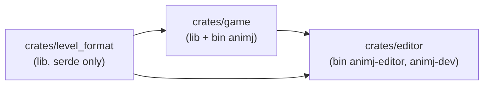
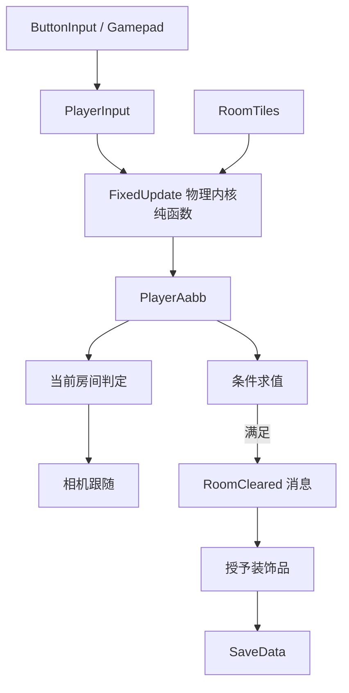

# 05 — 工程架构

> 契约与目录见 `00-conventions.md`。物理内核见 `06`，渲染管线见 `07`，依赖与 Cargo 见 `09`，Bevy API 速查见 `10`。

## 5.1 依赖方向



- **禁止反向依赖**：`game` 不得依赖 `editor`；`level_format` 不得依赖 `bevy`。
- 编辑器通过**复用 `game` 的插件**来获得「就地试玩」，而不是复制一份游戏逻辑。

## 5.2 模块树

### `crates/level_format/src/`

| 文件 | 内容 |
|---|---|
| `lib.rs` | 重导出 + crate 文档 |
| `types.rs` | `Level` / `Room` / `EntitySpec` / `Goal` / `Grid` / `RoomCoord`（见 `03` §3.2） |
| `legend.rs` | 字符 ↔ `TileKind` 映射（见 `03` §3.3） |
| `io.rs` | `read()` / `write()` 单入口（见 `03` §3.1） |
| `validate.rs` | `validate()` 纯函数，返回全部 `LevelIssue`（见 `03` §3.7） |
| `error.rs` | `LevelError` + `LevelIssue` + `Severity` + 手写 `Display`（不引入 `thiserror`，见 D15） |
| `migrate.rs` | 版本迁移函数（见 `03` §3.8）。**v1 无迁移可言，首次版本升级时才新增该文件** |

### `crates/game/src/`

| 路径 | 内容 |
|---|---|
| `lib.rs` | `pub fn add_game_plugins(app: &mut App)` —— 注册全部玩法插件，**不含** `DefaultPlugins`/窗口/资产源/任何编辑器类型。两个 bin 各自负责外壳（`DefaultPlugins`、`AssetPlugin.file_path` 见 `09` §9.6） |
| `config/{mod,physics,render,room}.rs` | **所有运行时常量的唯一代码落点**（所有者文档见各文件头注释） |
| `coords.rs` | `room_local_to_world` / `world_to_room` / `room_center`（`00` §0.3 的唯一换算入口） |
| `physics/{mod,aabb,tile,core,tests}.rs` | **纯函数物理内核**（`06`）：`Aabb`、`TileWorld`/`TileKind`、`step`、`overlaps_tile_kind`，以及 T1–T21 不变量测试 |
| `player/{mod,input,spawn,death}.rs` | ECS 适配层（`06` §6.1.5）：`PlayerMotion`/`PlayerInput`、输入采样、生成、Hazard 死亡与重生 |
| `demo.rs` | 验证用脚本输入与物理度量（`--demo walk` / `--demo jump`），见 `AGENTS.md` §4 |
| `tiles.rs` | `RoomTiles` / `LevelTiles` 存储、`tile_at_world`、以及 `TileWorld` 的房间映射实现（`06` §6.6） |
| `state.rs` | `GameState`、`GameSet` |
| `level_asset.rs` | `Level` 的 Bevy `Asset` 包装 + `AssetLoader` 注册 + `Asset` 事件热重载 |
| `world/load.rs` | 校验 → 生成瓦片 sprite → 生成实体与角色 → 放置玩家 |
| `world/progress.rs` | `LevelProgress` / `RoomProgress`（见 `02` §2.3） |
| `player/decor.rs` | 装饰品装备与图层渲染（`01` §1.5、`04` §6） |
| `checkpoint.rs` | 存档点：`E` 激活、`ActiveCheckpoint`、死亡/启动落点（`02` §2.5） |
| `camera/rig.rs` | 相机跟随：玩家 AABB 中心 + 地图边界钳制（`02` §2.2） |
| `room/mod.rs` | 当前房间判定（含滞回） |
| `room/goals.rs` | **纯函数**条件求值 + 通关判定（`01` §1.4） |
| `room/reward.rs` | 授予装饰品（幂等） |
| `render/pixel_camera.rs` | 双层相机 + 整数缩放（`07`） |
| `render/snap.rs` | 像素吸附 + `Aabb → Transform` 投影（`06` §6.8.2） |
| `render/tiles.rs` | 瓦片 sprite 批量生成 + 房间可见性裁剪 |
| `render/parallax.rs` | 2D 视差背景（`03` §3.10 / `07` §7.13）：贴图平铺、相位与滚动、编辑器预览覆盖、mtime 重载 |
| `render/sprite_anim.rs` | 自写帧动画（`04` §5） |
| `render/hud.rs` | 屏幕空间 HUD |
| `render/debug.rs` | gizmos 网格、`F3` 调试开关、诊断行（dev feature，见 `07` §7.9） |
| `anim_data.rs` | 角色动画数据（`assets/anim/player.anim.ron`，`04` §5.5）：类型/校验/加载器/内置回退 |
| `save/mod.rs` | `SaveData` + `save_path()` + 原子写（M6） |

> **当前进度（2026-10-17，M6 部分）**：：已落地 `lib.rs` / `config/{mod,physics,render,room}.rs` / `coords.rs` / `physics/**` /
> `player/{mod,input,spawn,death,decor}.rs` / `demo.rs` / `tiles.rs` / `state.rs` / `level_asset.rs` /
> `world/{mod,load,progress}.rs`（加载 + 校验 + 热重载 + 进度）/ `room/{mod,goals,reward}.rs`（房间判定、
> 传感器、条件求值、授奖、全通）/ `camera/{mod,rig}.rs`（无状态跟随 + 地图钳制）/ `render/{mod,pixel_camera,snap,tiles,hud,debug}.rs`。
> **尚未落地**：编辑器侧的区域框选（已明确移除，见 `08` §8.10.5）、音效（`04` 尚无音频资产规范）。
> 不要去找不存在的文件。

### `crates/editor/src/`

| 路径 | 内容 |
|---|---|
| `bin/animj_editor.rs` | `animj-editor` bin：构建带 egui 的 App，复用 `game::add_game_plugins`（路径见 `09` §9.5.4） |
| `bin/animj_dev.rs` | `animj-dev` bin：`validate-levels` / `gen-placeholder-assets`（见 `08` §8.10） |

> **M5 现状（2026-10-17）**：`editor` 已是 lib crate，按职责拆成下列模块；`bin/animj_editor.rs`
> 只剩外壳（CLI + 截图 + 帧上限）。`bin/animj_dev.rs` 里不得出现 `use bevy`（`08` §8.2.3）。

| 路径 | 内容 |
|---|---|
| `src/lib.rs` | `EditorMode`（编辑器独有状态）+ `EditorPlugin` + 首次从 `LoadedLevel` 取 `doc` |
| `src/session.rs` | `EditorSession`（唯一真相）、全量快照撤销/重做、原子保存、校验结果 |
| `src/camera.rs` | 唯一相机、档位缩放、平移、`Home`、`Tab` 切房间、光标→瓦片 |
| `src/view.rs` | `doc` 投影（瓦片/实体）+ Gizmos 网格/边界/当前房间 |
| `src/tools.rs` | 工具编号 1–6、拖拽所有权、线采样、实体放置/拖动 |
| `src/ui.rs` | egui 四栏面板（顶/左/右/底） |
| `src/playtest.rs` | 就地试玩：校验闸门 → 注入 `game` → 退出恢复 |
| `src/tile_tool.rs` | 地块工具：调色板增删改、贴图路径/列数、32×32 网格选格（`03` §3.9） |
| `src/anim_tool.rs` | 动画编辑工具：工作副本、帧增删、校验、原子保存（`04` §5.5） |
| `src/io.rs` | 编辑态热重载消费（检测 → 确认 → 文本级回环抑制） |
| `bin/animj_dev.rs` | `validate-levels` / `gen-placeholder-assets`（`08` §8.10） |

## 5.3 插件与职责

| 插件 | 职责 | 关键依赖 |
|---|---|---|
| `CorePlugin` | `GameState` / `GameSet` 注册、`Time<Fixed>` 配置 | 无 |
| `LevelAssetPlugin` | 注册 `Level` 资产与 loader | `level_format` |
| `WorldPlugin` | 关卡加载与生成、热重载（校验通过才替换）、`LevelProgress` | `LevelAssetPlugin` |
| `PhysicsPlugin` | — （M1 起物理并入 `PlayerPlugin`：`FixedUpdate` 的 `GameSet::Physics`；将来多实体物理再拆出） | `TilePlugin` |
| `TilePlugin` | `RoomTiles` 存储与查询 | `WorldPlugin` |
| `PlayerPlugin` | 输入采样、物理步推进、朝向（输入方向 ⇒ `PlayerFacing`，`01` §1.3）、Hazard 死亡与重生（`02` §2.5、`06` §6.1.5/§6.5.3） | `TilePlugin` |
| `CheckpointPlugin` | `E` 激活存档点、当前存档点状态与标记高亮（`02` §2.5） | `PlayerPlugin`、`RoomPlugin` |
| `PlayerSpawnPlugin` | 角色图集句柄（`04` §3.2） | 无 |
| `DemoPlugin` | 验证用脚本输入 + 物理度量（仅 `--demo` 时由 bin 添加） | 无 |
| `RoomPlugin` | 当前房间、条件求值、奖励 | `WorldPlugin` |
| `CameraRigPlugin` | 相机跟随玩家 AABB 中心并钳制在关卡 AABB 内（`GameSet::Camera`） | `WorldPlugin` |
| `ParallaxPlugin` | `Level.background` → 平铺 sprite；`ParallaxCamera` 视图换算；`BackgroundOverride` 预览；`PostUpdate` 早于 `Propagate` | `TileRenderPlugin`（`load_image`）、`WorldPlugin` |
| `PixelRenderPlugin` | 双层相机、窗口缩放、像素吸附 | 无 |
| `TileRenderPlugin` | 瓦片 sprite 生成与可见性 | `WorldPlugin` |
| `SpriteAnimPlugin` | 帧动画 + 按朝向水平翻转 sprite（装饰品同步镜像，`04` §4.5） | 无 |
| `SavePlugin` | 读档（版本/地图/存档点校验）+ 通关/授奖/设置存档点/退出即存 | `WorldPlugin`、`RoomPlugin` |
| `HudPlugin` | HUD（进度/提示条/结算面板） | `CorePlugin` |
| `PausePlugin` | 暂停菜单 + 装饰品装备界面（`GameState::Paused`，`Esc` 开关） | `CorePlugin` |
| `AudioFxPlugin` | 事件 → 音效（`04` §6.9；物理结果与 `05` §5.6 的消息） | `RoomPlugin`、`PlayerPlugin` |
| `DebugPlugin` | gizmos / 诊断（仅 `dev` feature） | 全部 |

## 5.4 调度顺序

```rust
// state.rs
#[derive(SystemSet, Debug, Clone, PartialEq, Eq, Hash)]
pub enum GameSet { Input, Physics, PostPhysics, Room, Camera, Fx, Snap }
```

| 调度 | 集合/系统 | 说明 |
|---|---|---|
| `PreUpdate` | `GameSet::Input` | 采样输入为 `PlayerInput`（纯数据） |
| `FixedUpdate` | `GameSet::Physics`：`apply_player_physics → activate_checkpoint → check_hazards → respawn_on_death`（依次排序） | 固定 60 Hz。**所有位移与碰撞只在这里发生**；存档点先于死亡判定，因此同一固定步里按 E 设置的点会立即生效 |
| `Update` | `GameSet::PostPhysics` | 把 `FixedUpdate` 结果同步到 `Transform`，触发一次性消息 |
| `Update` | `GameSet::Room` | 当前房间判定、条件求值、通关与奖励 |
| `Update` | `GameSet::Camera` | 相机跟随玩家（钳制在地图内） |
| `Update` | `GameSet::Fx` | 动画、粒子、音效触发 |
| `PostUpdate` | `GameSet::Snap`：`.before(TransformSystems::Propagate)`（`.after` 会延迟一帧，见 `07` §7.6.3） | 像素吸附（`07`） |

- `Time<Fixed>` 的配置（**已验证**，且 0.20 官方示例即用此写法）：`insert_resource(Time::<Fixed>::from_hz(60.0))`。
- 输入在 `PreUpdate` 采样 → `FixedUpdate` 消费：单帧内多次物理步会复用同一份输入（这正是平台跳跃想要的确定性）。
- **禁止**在 `Update` 里直接改位置；渲染层的插值/吸附是唯一例外，且不得回写逻辑 `Aabb`。

## 5.5 状态与模式

```rust
#[derive(States, Default, Clone, Copy, PartialEq, Eq, Hash, Debug)]
pub enum GameState { #[default] Boot, Loading, Playing, Paused, GameComplete }
```

| 状态 | 含义 | 就绪判据 |
|---|---|---|
| `Boot` | 注册资产、读取存档 | 立即转 `Loading` |
| `Loading` | 加载 `.level.ron`、校验、生成世界 | 加载 + 校验通过 → `Playing`；失败 → 停留在 `Loading` 并显示错误文本 |
| `Playing` | 正常游戏 | — |
| `Paused` | 暂停菜单、装饰品装备 | 冻结物理与计时 |
| `GameComplete` | 全部房间通关的结算 | 可返回 `Playing` 继续探索 |

- **门控规则**：玩法系统（`GameSet::Input` / `Physics` / `PostPhysics` / `Room` / `Camera` / `Fx`）统一以 `in_state(GameState::Playing)` 为 run condition；跨状态系统（`Snap`、HUD、存档、调试）不门控或按各自状态门控。
- 编辑器因此**零侵入**地复用同一套插件：编辑态把 `GameState` 停在 `Paused`，试玩时置 `Playing`（见 `08` §8.3 / §8.6）。编辑器**不得**给任何 `game` 系统追加 `run_if`，`game` 也**不得**知道编辑器的存在。
- **游戏不用状态机表达"房间是否通关"**：房间无缝，通关是进度数据（`02` §2.3），不是状态。

## 5.6 数据流与消息



| 消息/事件 | 种类 | 载荷 | 发布者 → 消费者 |
|---|---|---|---|
| `PlayerInput` | 资源 | `move_x: i8`, `jump_pressed: bool`, `jump_held: bool`, `interact_pressed: bool` | `player/input` → 物理/存档点 |
| `PlayerDied` | `Message` | `room_index: u32` | `player/death` → 音效/特效/HUD |
| `CheckpointActivated` | `Message` | `point: CheckpointPoint`（房间 + 局部 `at`） | `checkpoint` → 存档（立即写盘） |
| `RoomEntered` | `Message` | `room_index: u32` | `room` → HUD/调试/编辑器 |
| `RoomCleared` | `Message` | `room_index: u32` | `room/goals` → 奖励/HUD/存档 |
| `DecorationGranted` | `Message` | `decoration_id: String` | `room/reward` → HUD/存档 |
| `CollectiblePicked` | `Message` | `room_index: u32` | `room` 传感器 → HUD/音效（`06` §6.5.4） |
| `LevelValidated` | `Message` | `issues: Vec<LevelIssue>` | 加载/编辑器 → HUD/编辑器面板 |

- 跨模块通信优先用**消息**（buffered，`Message` 派生；0.20 中 `EventWriter/EventReader` 已不存在，见 `10`）。
- 仅当需要"针对某个实体、且需要冒泡到父级"时才用 observer（`EntityEvent` + `On<E>`）。
- **禁止**用全局可变资源传递帧内中间状态（唯一例外：`PlayerInput`、`LevelProgress`、`SaveData`）。

## 5.7 纯函数内核边界（可测试性的关键）

以下逻辑**必须**是无 Bevy 依赖的纯函数，输入输出都是普通结构体：

| 函数 | 输入 | 输出 |
|---|---|---|
| `coords::room_local_to_world` / `world_to_room` | 标量与 `Vec2` 风格值 | 标量 / 元组 |
| `movement::step` | `PlayerBody`（位置/速度/状态）+ `PlayerInput` + `LevelTiles` + `dt` | 新 `PlayerBody` + 事件列表 |
| `collide::sweep_aabb` | `Aabb` + 位移 + `LevelTiles` | 修正后 `Aabb` + 命中的瓦片边 |
| `goals::evaluate` | `&[Goal]` + `&RoomFacts` | `bool` |
| `tiles::tile_at_world` | 世界坐标 + `LevelTiles` | `TileKind` |

- ECS 系统只做三件事：取数据 → 调纯函数 → 写回组件/发消息。
- 好处：物理、条件、坐标的**全部**测试都不需要 Bevy，跑得快、无窗口、可确定性复现。

## 5.8 错误处理

| 层 | 策略 |
|---|---|
| `level_format` | 显式 `Result`，`LevelError` 手写 `Display`；错误必须带字段路径 |
| 关卡加载 | 失败**不静默降级**；`GameState::Loading` 显示可定位的错误（房间下标 + 字段） |
| 玩法系统 | 不 panic。数据异常 → `warn!` + 跳过该帧/该实体 |
| `unwrap()` / `expect()` | 仅允许在测试中，或 `Option` 已被同作用域证明为 `Some` 且附注释说明不变量 |
| `panic!` / `todo!` / `unimplemented!` | **禁止**进入 `main` 分支的代码路径 |

## 5.9 常量组织

- 所有运行时常量集中在 `crates/game/src/config.rs`，按主题分子模块（`physics` / `render` / `room`）。
- 每个常量上方必须有指向**所有者文档**的注释，例如：

```rust
/// 见 docs/06-physics-and-movement.md §3
pub const GRAVITY: f32 = /* … */;
```

- **禁止**在任何其它文件里写裸数字常量（`0.25`、`512.0` 之类）。要么提进 `config.rs`，要么来自所有者文档。
- 文档是**规范**，`config.rs` 是**实现**。两者不一致 = bug，必须同一次改动内对齐。

## 5.10 测试策略

| 层 | 测什么 | 位置 |
|---|---|---|
| 单元 | `level_format`：解析、legend、全部校验规则（每条规则至少一个正例 + 一个反例）、`write → read` 往返相等 | `crates/level_format/tests/` |
| 单元 | `coords`：往返换算、四个角落、跨房间边界 | `crates/game/src/coords.rs` 内 `#[cfg(test)]` |
| 单元 | `movement` / `collide`：`06` §测试清单的每一条不变量 | `crates/game/src/player/` |
| 单元 | `goals::evaluate`：条件组合、边界（0/全部/超量） | `crates/game/src/room/` |
| 单元 | `render::debug::toggled`：输入的 `just_pressed` 语义（长按与松开都不得翻转） | `crates/game/src/render/debug.rs` 内 `#[cfg(test)]` |
| 集成（无头） | **输入链路**：`MinimalPlugins` + `InputPlugin`，注入 winit 同型的 `KeyboardInput` 消息 → `ButtonInput<KeyCode>` → 系统行为。它同时钉住**调度顺序**（读输入的系统必须在 `Update`，晚于输入系统的 `PreUpdate`） | 同上 |
| 集成 | `simulate(level, scripted_inputs, frames)` 无 Bevy 确定性回放：断言最终位置、通关状态 | `crates/game/tests/` |

- 测试**不得**依赖窗口 / GPU / 显示器；需要 Bevy 的测试用 `MinimalPlugins` 搭无头 App（**已验证可用**，见 `10` §10.2.8）。
- **输入类行为不要靠 OS 级按键注入验证**（`SetForegroundWindow` 在无交互桌面的会话里会被拒、`PostMessage` 会被 winit 因为窗口无焦点而丢弃）。注入 `KeyboardInput` 消息能覆盖到「winit 之上」的全部链路，且是确定性的。

- 新增玩法逻辑若无法用纯函数测试，说明设计有问题 → 先重构内核，再写功能。

## 5.11 存档

```rust
pub struct SaveData {
    pub version: u32,                 // 当前 1
    pub level_name: String,           // 与 .level.ron 的 name 一致
    pub grid: (u32, u32),             // 校验同一张地图
    pub progress: LevelProgress,      // 见 02 §2.3
    pub owned_decorations: Vec<String>,
    pub equipped: Vec<Option<String>>,// 长度 == DECORATION_LAYERS（见 04）
    pub checkpoint: Option<CheckpointPoint>, // 已激活存档点（`02` §2.5）；旧存档缺省 = None
}

pub struct CheckpointPoint { pub col: u32, pub row: u32, pub at: (i32, i32) }
```

| 规则 | 说明 |
|---|---|
| 路径 | `save_path()` 单一函数决定：Windows `%APPDATA%\animj\save.ron`，其它平台 `$XDG_DATA_HOME/animj/save.ron` 或 `$HOME/.local/share/animj/save.ron` |
| 原子写 | 先写 `save.ron.tmp`，再 rename 覆盖。禁止原地截断写 |
| 版本不符 | `version != 1` → 忽略存档并提示，不猜测 |
| 地图不符 | `level_name` 或 `grid` 与当前关卡不同 → 忽略进度（保留装饰品清单？**否**，一并忽略，避免出现"有装饰品但没通关房间"的矛盾态） |
| 存档点失效 | `checkpoint` 必须仍能在关卡数据里找到同房间同 `at` 的 `checkpoint` 实体；否则只丢弃存档点，其余进度照常恢复 |
| 启动 | 有有效存档点 ⇒ 从存档点所在房间/位置开始；否则从 `player_spawn` 所在房间开始 |
| 保存时机 | 通关（`RoomCleared`）/ 授奖（`DecorationGranted`）/ 设置存档点（`CheckpointActivated`）/ `AppExit` 各写一次；暂停菜单的「SAVE」「QUIT & SAVE」走同一条 `persist_now` |
| 自动化覆盖 | 环境变量 `ANIMJ_SAVE_DIR` 覆盖存档目录（CI / `--demo` 验证用；不改变发布行为） |

## 5.12 代码规范

| 项 | 约定 |
|---|---|
| 格式化 | `cargo fmt` 全仓通过 |
| Lint | `cargo clippy --workspace --all-targets -- -D warnings` 零警告 |
| 可见性 | 默认私有；跨模块只 `pub` 必需项；不用 `pub(crate)` 兜底整模块 |
| 文档注释 | 所有 `pub` 项有 `///`；引用文档时写 `见 docs/06-… §…` |
| 注释风格 | 解释**为什么**，不解释**是什么**。禁止注释掉的死代码 |
| 死代码 | 立即删除。禁止留 `#[allow(dead_code)]` 掩盖 |
| Git | 一个提交一件事；信息格式 `scope: 祈使句摘要`，如 `physics: 修正单向平台在上升期的穿透` |
