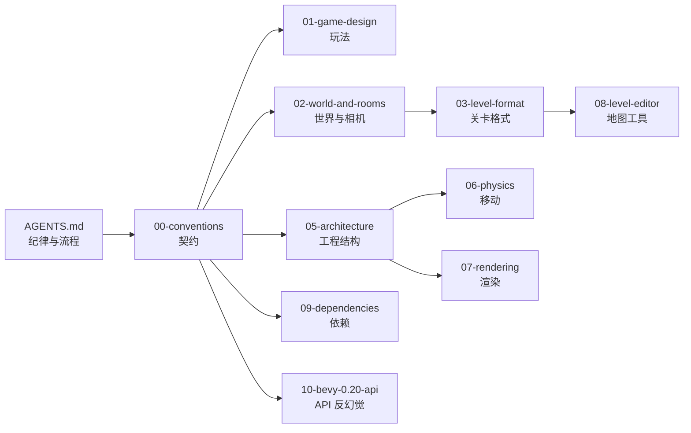

# animj — 开发规范文档

Bevy **0.20** 像素风 2D 平台跳跃游戏的规范文档集。**本目录是项目规范与契约的唯一权威来源。**

## 当前状态（2026-10-20）

**M0 骨架 · M1 角色移动 · M2 房间与相机 · M3 关卡数据 · M4 目标与奖励 · M5 关卡编辑器 · M6 打磨 · M7 基础界面 已完成并通过验证** —— 判据见 `01` §1.9，实测明细见 `09` §9.8.1 与各文档的「已完成」标注。

| 位置 | 内容 |
|---|---|
| `crates/level_format/` | 关卡数据结构、legend、`read`/`write`、V1–V18 校验（**零 bevy 依赖**，36 个测试） |
| `crates/game/` | 玩法 crate：**主菜单 / 关卡选择 / 设置（音量、全屏）**、**存档读档**、暂停菜单与装饰品装备、**角色帧动画**、双层像素相机、像素吸附、瓦片渲染 + 房间裁剪、关卡加载 + 校验 + 热重载、房间判定（8 px 滞回）、**相机跟随玩家（钳制在地图内）**、**条件求值/拾取/通关/授奖/结算**、HUD（进度 + 提示条 + 结算面板）、调试叠层；bin `animj` |
| `crates/editor/` | lib `editor`（会话/撤销/相机/投影/Gizmos/工具/面板/试玩）+ bin `animj-editor`、bin `animj-dev`（`validate-levels` / `gen-placeholder-assets`） |
| `assets/` | 占位资产（图集 + 30 件装饰品 + 7 个音效 WAV + `anim/player.anim.ron`，规格符合 `04`）+ `world_01.level.ron`（10×3 = 30 房间；两处竖井带单向台阶可上行，保存即热重载） |

常用命令（别名见 `.cargo/config.toml`，纪律与判据见 `AGENTS.md` §4）：

```bash
cargo game                                           # 无参数启动：主菜单
cargo game -- --demo menu --frames 90 --screenshot target/menu       # 主菜单截图（levels/settings 同理）
cargo game -- --demo menu-start --frames 200         # 主菜单 → 关卡选择 → 进入游戏
cargo game -- --frames 90 --screenshot target/m0   # 直接进默认关卡；导出内层画布与窗口两张截图
cargo game -- --demo jump --frames 3000             # 脚本输入跑一段：日志给出每次跳跃的实测峰值
cargo game -- --demo walk --frames 3000             # 走过房间边界与出口：日志给出房间切换、通关（M4）
cargo game -- --demo hop --frames 3000              # 连续小跳：检查平台/尖刺/果实几何（不是通关判据）
cargo game -- --demo pause --frames 120 --screenshot target/pause  # 暂停菜单冒烟（Esc 在无头会话不可注入）
cargo editor                                         # 打开编辑器（M5：画瓦片 / 放实体 / 改条件 / 保存 / F5 试玩）
cargo editor -- --frames 140 --demo-play             # 自动化：进入试玩→退出，并断言编辑缓冲未变
cargo dev-cli -- validate-levels --deny-warnings     # 关卡体检（退出码 0 才算过）
cargo dev-cli -- gen-placeholder-assets --check      # 占位资产防漂移（逐字节比对）
cargo test-all                                       # 全仓测试（当前 162 项：level_format 41（39 集成 + 2 单元）+ game 90 + editor 31）
```

进度：**M0–M7 ✅**（编辑器遗留 5 项已补齐；可选细化见 `08` §8.10.5）。M1–M7 的完成判据见 `01` §1.9；各模块「已落地 / 尚未落地」见 `05` §5.2 的进度注记。

---

## 阅读顺序



**第一次进入本仓库，按这个顺序读**：`AGENTS.md` → `00` → `01` → `02` → `03` → `05` → 按需读 `06`/`07`/`08`。

---

## 文档索引

| # | 文档 | 一句话 |
|---|---|---|
| — | [`AGENTS.md`](AGENTS.md) | 开发纪律、完成定义、验证命令矩阵、标准流程 checklist |
| — | [`README.md`](README.md) | 本文件：索引与状态 |
| `00` | [`00-conventions.md`](00-conventions.md) | **契约**：已锁定决策、坐标系统、命名、Z 层、常量归属、目录布局 |
| `01` | [`01-game-design.md`](01-game-design.md) | 核心循环、房间目标条件、装饰品、通关、里程碑与非目标 |
| `02` | [`02-world-and-rooms.md`](02-world-and-rooms.md) | 房间网格、无缝衔接、相机跟随与地图边界、房间状态、重生 |
| `03` | [`03-level-format.md`](03-level-format.md) | `.level.ron` schema、legend、实体注册表、校验规则 V1–V18 |
| `04` | [`04-assets.md`](04-assets.md) | 美术资源规格、图集、锚点、帧动画、装饰品图层、占位资产 |
| `05` | [`05-architecture.md`](05-architecture.md) | crate 划分、模块树、插件、调度顺序、消息、测试策略 |
| `06` | [`06-physics-and-movement.md`](06-physics-and-movement.md) | AABB 碰撞算法、移动手感常量、宽容机制 |
| `07` | [`07-rendering.md`](07-rendering.md) | 像素完美双层相机、采样/MSAA/色调映射、像素吸附、瓦片渲染 |
| `08` | [`08-level-editor.md`](08-level-editor.md) | 地图设计工具：选型、工具集、就地试玩、热重载 |
| `09` | [`09-dependencies.md`](09-dependencies.md) | 依赖矩阵（含 0.20 不可用项）、feature、Cargo 配置 |
| `10` | [`10-bevy-0.20-api.md`](10-bevy-0.20-api.md) | Bevy 0.20 API 速查 + **过期名称黑名单** + 取证方法 |

---

## 三条铁律

1. **常量只有一个所有者文档。** 跨文档引用写「见 `06` §6.2」，不得复制数值。
2. **Bevy API 不得凭记忆书写。** 落笔前先查 `10`，查不到就去 `docs.rs/bevy/0.20.0`，仍查不到就写最小验证代码并把结论回填 `10`。
3. **与文档冲突时以文档为准。** 文档有错 → 改文档；不要绕过它写"更合理"的代码。

详细流程见 [`AGENTS.md`](AGENTS.md)。
